# AI Software Factory

**An AI engineering team you can watch work.**

Most AI coding tools give you a spinner and then a wall of diff. This one gives
you a floor plan. Twelve desks, each an agent with a name and a job. When the
backend agent reads a file, its monitor lights up. When the tester's suite goes
red, the desk turns red. When the reviewer approves, you see it happen — with a
timestamp, in a feed, on the same screen.

**[▶ Open the live demo](https://ai-software-factory-qadir-khan.vercel.app)** — no
install, no API key. (The hosted build runs the simulation; clone the repo to
watch real agents write real code.)

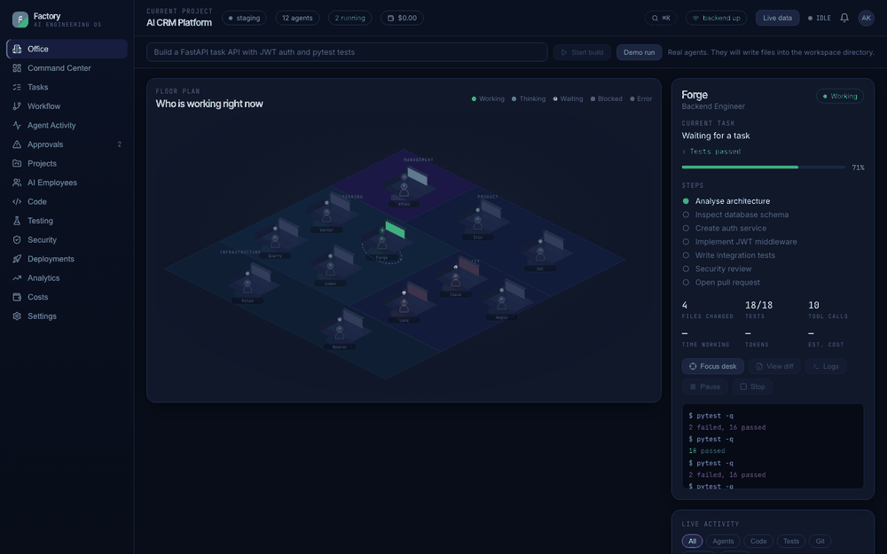

*Every frame above is the running application. There are no mockups in this
repository.*

---

## Table of Contents

1. [Project Overview](#1-project-overview)
   - [What it does](#what-it-does)
   - [The problem it solves](#the-problem-it-solves)
   - [Key features](#key-features)
   - [High-level architecture](#high-level-architecture)
2. [Architecture](#2-architecture)
   - [System overview](#system-overview)
   - [Backend components](#backend-components)
   - [Frontend components](#frontend-components)
   - [Request and event flow](#request-and-event-flow)
   - [The agent loop](#the-agent-loop)
   - [The build pipeline](#the-build-pipeline)
   - [Threading model](#threading-model)
   - [Design rules the code enforces](#design-rules-the-code-enforces)
3. [Project Structure](#3-project-structure)
4. [Prerequisites](#4-prerequisites)
5. [Installation](#5-installation)
   - [Environment variables](#environment-variables)
6. [Running the Project](#6-running-the-project)
   - [Development](#development)
   - [The CLI](#the-cli-no-server-required)
   - [Docker](#docker)
   - [Production](#production)
   - [Available scripts](#available-scripts)
7. [Screenshots](#7-screenshots)
8. [API Documentation](#8-api-documentation)
   - [Authentication](#authentication)
   - [REST endpoints](#rest-endpoints)
   - [WebSocket `/stream`](#websocket-stream)
   - [Event shapes](#event-shapes)
   - [Error responses](#error-responses)
   - [Rate limits](#rate-limits)
9. [Database](#9-database)
   - [Schema](#schema)
   - [ER diagram](#er-diagram)
   - [Migrations](#migrations)
   - [Seeding](#seeding)
10. [Configuration](#10-configuration)
11. [Development Guide](#11-development-guide)
    - [Learn this codebase in eight steps](#learn-this-codebase-in-eight-steps)
    - [Coding standards](#coding-standards)
    - [Linting and formatting](#linting-and-formatting)
    - [Testing](#testing)
    - [Build process](#build-process)
    - [Debugging tips](#debugging-tips)
    - [Extending the system](#extending-the-system)
12. [Deployment](#12-deployment)
13. [Troubleshooting](#13-troubleshooting)
    - [Common issues](#common-issues)
    - [Known limitations](#known-limitations)
14. [Contributing](#14-contributing)
15. [License](#15-license)

---

## 1. Project Overview

### What it does

AI Software Factory takes a plain-English software requirement, breaks it into
tasks, writes the code, tests it, fixes what fails, reviews the result, and
stops at a human approval gate before anything ships — while rendering every
step of that process live as an animated office floor.

Two halves, both runnable independently:

| Half | What it is | Language |
|---|---|---|
| `backend/` | The agent pipeline plus a FastAPI + WebSocket event bridge | Python |
| `frontend/` | A Next.js app: the office floor and fifteen screens over the event stream | JavaScript / JSX |

There is no agent framework, no state-management library, no component library
and no game engine anywhere in it. The isometric floor plan is one projection
function and about 200 lines of polygons.

### The problem it solves

An AI agency has an honesty problem: the client can't see the work, and often
neither can you. *"It's 70% done"* means nothing when the thing doing the work
is a loop you can't watch.

Most dashboards bolt observation on afterwards: the system does the work, then a
reporting layer describes it. Those two drift apart, and the description wins,
because it's the only thing anyone reads.

This project inverts that — **emitting the event is how the work gets done**.
The `emit()` call sits on the same line as the tool call in
[`agency/runtime.py`](backend/agency/runtime.py). If a tool ran, an event
exists. There is no reporting layer that *can* drift.

### Key features

| Feature | Where it lives |
|---|---|
| **Four working agents** — planner, coder, tester, reviewer | [`backend/agency/agents.py`](backend/agency/agents.py) |
| **Six sandboxed tools** — list, read, write, edit, grep, shell | [`backend/agency/tools.py`](backend/agency/tools.py) |
| **Tool allowlists as the permission system** — the reviewer has no write tools at all | [`backend/agency/agents.py`](backend/agency/agents.py) |
| **A workspace sandbox** with one choke-point path check, covered by a test | [`backend/agency/tools.py`](backend/agency/tools.py) |
| **Test → fix convergence loop**, capped at `fix_attempts` | [`backend/agency/orchestrator.py`](backend/agency/orchestrator.py) |
| **Human approval gate** before anything reaches production | [`backend/agency/orchestrator.py`](backend/agency/orchestrator.py) |
| **Event-sourced bus** — SQLite append-only log + in-memory projections + WebSocket fanout | [`backend/agency/events.py`](backend/agency/events.py) |
| **Three model providers** behind one adapter — Anthropic, OpenAI, xAI | [`backend/agency/llm.py`](backend/agency/llm.py) |
| **A demo run** that needs no API key and calls no model | [`backend/agency/demo.py`](backend/agency/demo.py) |
| **Two office renderers** — pixel-art canvas and isometric SVG | [`frontend/components/office/`](frontend/components/office) |
| **Fifteen screens**, all projections of the same event feed | [`frontend/components/screens/`](frontend/components/screens) |
| **Deep-linkable routing** (`?screen=security`) and a ⌘K command palette | [`frontend/components/Shell.jsx`](frontend/components/Shell.jsx) |
| **Offline simulation** so a dead socket never looks like an idle team — always labelled | [`frontend/lib/mockEngine.js`](frontend/lib/mockEngine.js) |
| **Token and cost accounting** per agent, per run | [`backend/agency/llm.py`](backend/agency/llm.py) · [`frontend/lib/derive.js`](frontend/lib/derive.js) |

### High-level architecture

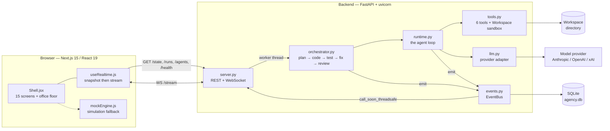

---

## 2. Architecture

### System overview

The system is an **event-sourced pipeline with a live projection**. Three facts
describe the whole design:

1. **The log is the truth.** Every observable action appends a row to
   `agent_events` in SQLite before anything renders it.
2. **Everything else is a projection.** The in-memory `snapshot` / `tasks` /
   `approvals` dicts on the bus, and all fifteen UI screens, are folds over that
   same log. There is no `files` table and no `test_runs` table — the Code and
   Testing screens are computed from the feed in
   [`lib/derive.js`](frontend/lib/derive.js).
3. **Capability is granted by handing over a function.** An agent's `tool_names`
   list *is* its permission set. A prompt cannot talk its way past it.

### Backend components

| Module | Lines | Responsibility |
|---|---|---|
| [`agency/tools.py`](backend/agency/tools.py) | ~185 | The six tools and the `Workspace` sandbox. Every path resolves through `Workspace.path()`, which raises if the result escapes the root. Also holds the JSON schemas sent to the model. |
| [`agency/runtime.py`](backend/agency/runtime.py) | ~187 | `Agent` and `Usage` dataclasses, `run_agent()` (the loop), `ask_json()` (a tool-less call whose reply is parsed as JSON), and `_report_command_result()` which turns raw pytest output into structured test events. |
| [`agency/agents.py`](backend/agency/agents.py) | ~80 | Four agent definitions. Each is a system prompt plus a tool allowlist plus an `office_id` naming the desk it sits at. |
| [`agency/orchestrator.py`](backend/agency/orchestrator.py) | ~140 | `build()` — the pipeline. Also normalises whatever shape the planner returns, writes `.agency/plan.json` and `.agency/run.jsonl`, and estimates cost. |
| [`agency/events.py`](backend/agency/events.py) | ~186 | `EventBus`: SQLite persistence, in-memory projections, subscriber fanout, replay. Plus `TOOL_EVENTS`, the fixed tool→phrasing table. |
| [`agency/llm.py`](backend/agency/llm.py) | ~195 | Provider detection, model defaults, prices, and an OpenAI/xAI adapter that emits Anthropic-shaped content blocks so `runtime.py` never learns which provider it's talking to. Built lazily — importing without a key is fine. |
| [`agency/demo.py`](backend/agency/demo.py) | ~115 | A 17-step scripted run emitting exactly the same event shapes as a real one. No key, no model calls, no files written. |
| [`server.py`](backend/server.py) | ~194 | FastAPI app: REST endpoints, the `/stream` WebSocket, CORS, and the worker-thread launcher with its one-run-at-a-time lock. |
| [`run.py`](backend/run.py) | ~51 | CLI entrypoint. `argparse` over `build()` and `demo.run()`. |
| [`test_tools.py`](backend/test_tools.py) | ~31 | Smoke test for the tool layer, including the sandbox boundary. Runs without an API key. |

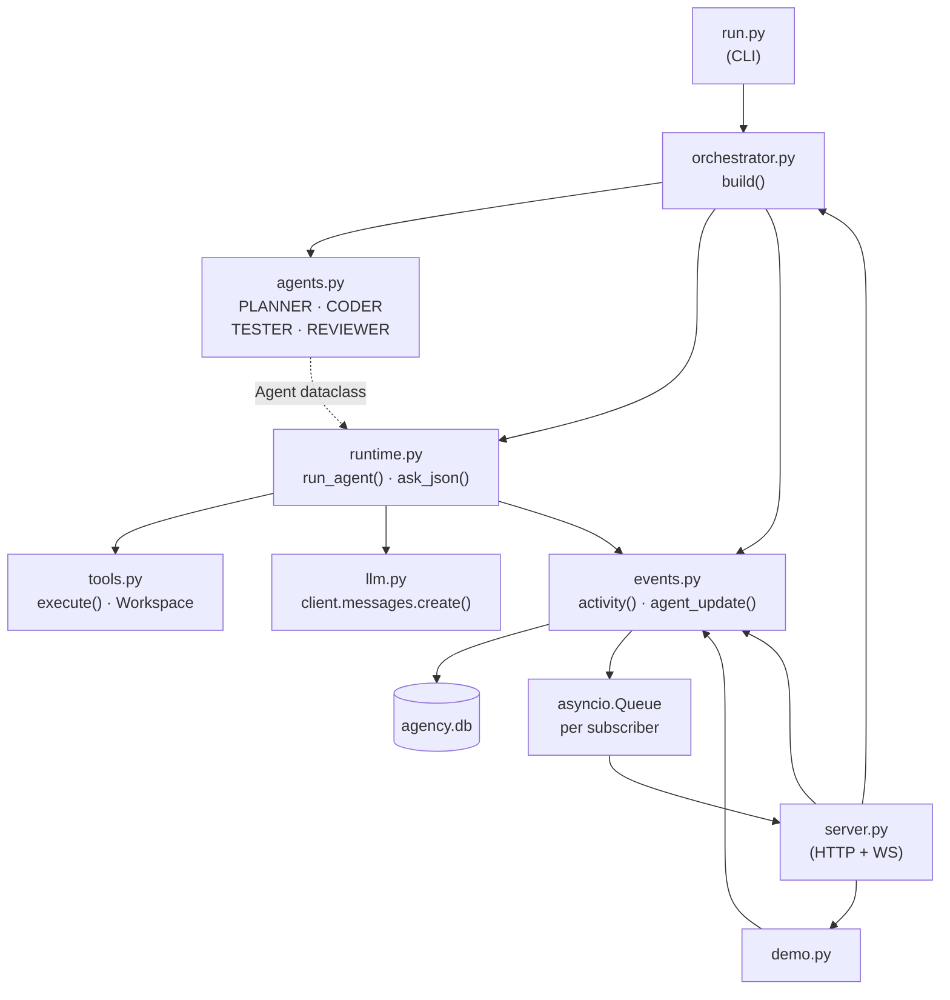

> [!NOTE]
> `agents.py` imports `Agent` from `runtime.py`, not the other way round. The
> runtime knows nothing about *which* agents exist — which is why adding a
> fifth agent touches two files and no plumbing.

### Frontend components

| Path | Responsibility |
|---|---|
| [`app/page.jsx`](frontend/app/page.jsx) | The only route. Reads `NEXT_PUBLIC_API_URL` and passes it down. |
| [`app/layout.jsx`](frontend/app/layout.jsx) | HTML shell and metadata. |
| [`app/globals.css`](frontend/app/globals.css) | All styling — 379 lines, no CSS framework. Includes a `prefers-reduced-motion` block that stops every animation. |
| [`components/OfficeClient.jsx`](frontend/components/OfficeClient.jsx) | Loads `Shell` with `ssr: false`. The app is a live view of sockets and clocks; pre-rendering it only creates hydration mismatches. |
| [`components/Shell.jsx`](frontend/components/Shell.jsx) | Sidebar, top bar, run bar, URL routing, ⌘K binding, and the `live` switch that decides which data source every screen reads. |
| [`components/office/PixelOffice.jsx`](frontend/components/office/PixelOffice.jsx) + [`lib/pixel.js`](frontend/lib/pixel.js) | The pixel-art floor: a 576×376 logical canvas of `fillRect` calls redrawn at ~6fps, scaled up with `image-rendering: pixelated`. Includes a 3×5 bitmap font defined as bit strings. |
| [`components/office/Floor.jsx`](frontend/components/office/Floor.jsx) | The isometric SVG floor. Projection is `iso(gx, gy) => ({x: (gx-gy)*46, y: (gx+gy)*23})`; polygons sort back-to-front by `gx + gy`. |
| [`components/office/WorkerBar.jsx`](frontend/components/office/WorkerBar.jsx) | The roster strip under the pixel office. |
| [`components/AgentPanel.jsx`](frontend/components/AgentPanel.jsx) | Per-desk detail: current task, files changed, tool calls, tests, tokens, and the raw terminal lines. |
| [`components/ActivityFeed.jsx`](frontend/components/ActivityFeed.jsx) | The event list and its category filter chips. |
| [`components/CommandPalette.jsx`](frontend/components/CommandPalette.jsx) | ⌘K. Commands are built from live state, so it can't list something that isn't there. |
| [`components/screens/`](frontend/components/screens) | Fourteen screen components (the Office screen is rendered inline in `Shell.jsx`). |
| [`lib/useRealtime.js`](frontend/lib/useRealtime.js) | The client projection: `GET /state` for first paint, `WS /stream` for updates, reconnect with backoff, dedupe on replay, plus a 5s poll for run state and history. |
| [`lib/derive.js`](frontend/lib/derive.js) | `useFiles`, `useTestRuns`, `useAnalytics`, `useCosts` — folds over the feed. |
| [`lib/mockEngine.js`](frontend/lib/mockEngine.js) | The simulation. Returns the same shape as `useRealtime`, so screens can't tell the difference. |
| [`lib/roster.js`](frontend/lib/roster.js) | Desks, rooms, the pipeline graph, filter definitions. **Desk ids must match `office_id` on the backend agents** or an event arrives with nowhere to sit. |
| [`lib/theme.js`](frontend/lib/theme.js) | Design tokens: colours and the status→colour map. |
| [`lib/types.ts`](frontend/lib/types.ts) | The event and entity contract, as TypeScript types. Mirror it when you add a backend field. |

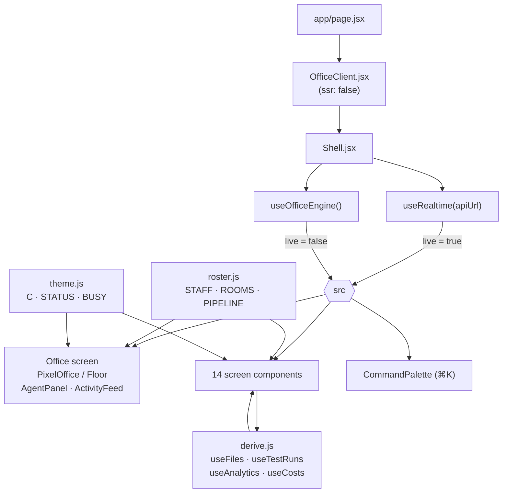

### Request and event flow

What happens between clicking **Start build** and a desk lighting up:

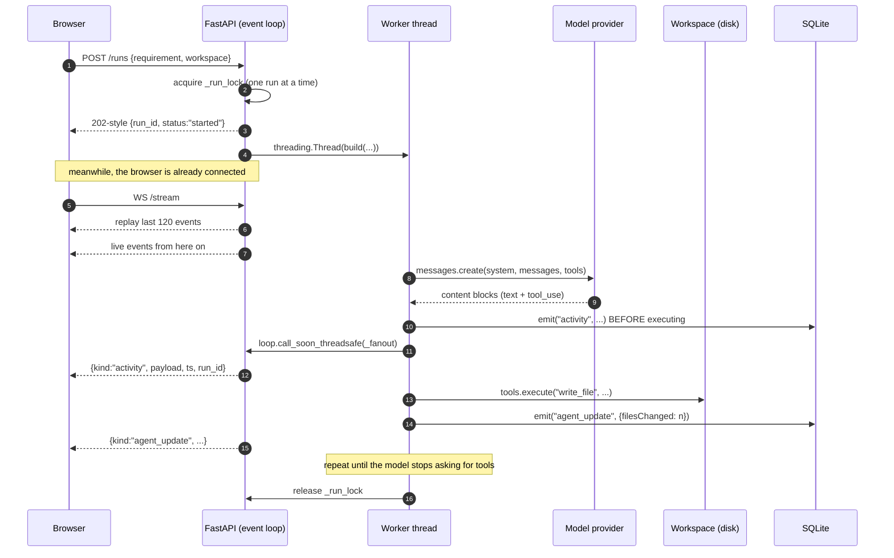

> [!IMPORTANT]
> The activity event is emitted **before** the tool executes, not after. That is
> what makes the office show work *in flight* rather than only completed work —
> and it means an event survives a crash mid-tool.

### The agent loop

The core concept of the whole project, in about 60 lines of
[`runtime.py`](backend/agency/runtime.py):

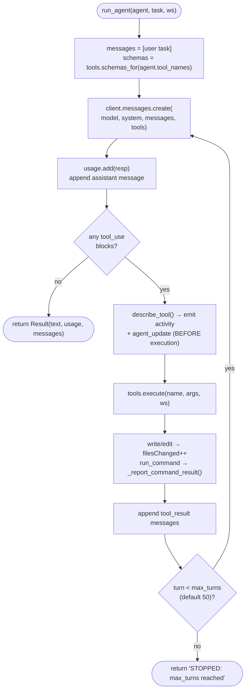

An "agent" is not a framework. It is a while-loop that keeps feeding tool
results back to a model until the model stops asking for tools.

### The build pipeline

`build(requirement, workspace, max_fix_attempts=2)` in
[`orchestrator.py`](backend/agency/orchestrator.py):

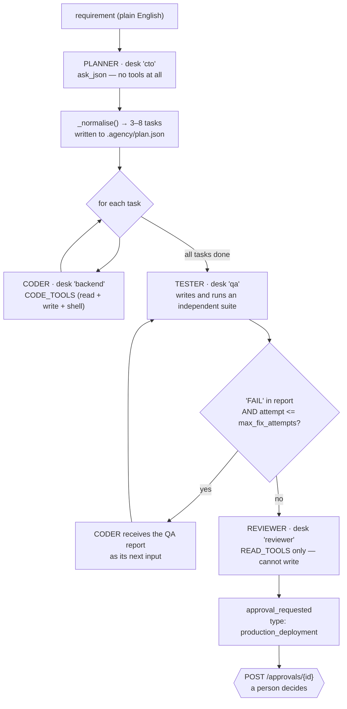

Three properties fall out of that shape:

- **The tester never fixes and the coder never grades itself.** The tester's
  report becomes the coder's next input. That loop is what turns a code
  generator into something that converges.
- **Capping the loop** at `max_fix_attempts` is what stops it looping forever.
- **The gate is not optional.** `build()` always emits an
  `approval_requested` event; nothing in the pipeline resolves it.

> [!WARNING]
> The tester holds `CODE_TOOLS`, so it *can* write files — it needs to, in order
> to write a test suite. "The tester does not fix the implementation" is enforced
> by its system prompt, not by the allowlist. The **reviewer** is the agent whose
> restriction is structural: `READ_TOOLS` contains no `write_file` or
> `edit_file`, so it cannot write code even if it decides to. `GET /agents`
> reports this honestly as `canWrite` per agent.

### Threading model

The agent pipeline is blocking, synchronous Python. FastAPI is async. Exactly
one thing crosses that boundary:

```python
# backend/agency/events.py
if self._loop is not None:
    self._loop.call_soon_threadsafe(self._fanout, msg)
```

`server.py` binds the loop once at startup (`bus.bind_loop(...)` in the
`lifespan` hook), a run happens on a `threading.Thread`, and `emit()` hands
finished messages back. Nothing else is shared. That is why the agent code
stays plain, readable Python with no `async` anywhere in it.

The fanout is deliberately lossy in one direction: a subscriber queue is capped
at 500, and a full queue is dropped from the subscriber set rather than awaited.
A browser tab that stopped reading must not stall the agents.

### Design rules the code enforces

| Rule | Where | Why it matters |
|---|---|---|
| **An agent is a while-loop** | `runtime.py` | Model call → tool calls → results → repeat. No framework needed to understand or debug it. |
| **Tool allowlists are the permission system** | `agents.py` | Capability is granted by handing over a function, not by asking a model politely. |
| **Sandbox at one choke point** | `tools.py` | One `Workspace.path()` every tool routes through beats six scattered checks. |
| **Emit before you execute** | `runtime.py` | Events show work in flight, and survive a crash mid-tool. |
| **Structured events, never prose** | `events.py` | `TOOL_EVENTS` is a fixed tool→phrasing table. No field in the pipeline carries model reasoning, so none can reach the screen. |
| **Event sourcing + projections** | `events.py` | Append-only log, in-memory summaries. Replay, audit and history come free. |
| **Thread → event loop handoff** | `events.py` | `call_soon_threadsafe` lets blocking agent code coexist with an async API. |
| **Snapshot then stream** | `useRealtime.js` | First paint from `/state`, updates from the socket. No empty screens, no polling for events. |
| **Dedupe on replay** | `useRealtime.js` | The server replays on every connect; without `seenRef`, a dropped connection silently duplicates the feed. |
| **Two sources, one UI** | `mockEngine.js` | Simulation and socket return identical shapes, so the product demos with the backend down — labelled, never disguised. |
| **Derive, don't duplicate** | `derive.js` | Screens compute from the log rather than keeping their own state, so no two screens can disagree. |
| **Say what you don't do** | `SecurityScreen.jsx` | Empty states name the gap instead of showing a plausible number. |

The phrasing table is worth seeing in full, because it is the guarantee:

```python
# backend/agency/events.py
TOOL_EVENTS = {
    "read_file":    ("file_read",         "code", "working", "Reading {}"),
    "write_file":   ("file_created",      "code", "working", "Creating {}"),
    "edit_file":    ("file_modified",     "code", "working", "Modifying {}"),
    "search_code":  ("search_performed",  "code", "working", "Searching repository for {}"),
    "list_files":   ("tool_called",       "code", "working", "Inspecting the repository"),
    "run_command":  ("tool_called",       "code", "working", "Running {}"),
}
```

`read_file` becomes *"Reading auth/service.py"*. You see what the agent **did**,
never what it "thought" — a structural guarantee, not a promise.

---

## 3. Project Structure

```
ai-factory/
├── README.md                       this file
├── START-HERE.md                   the two-minute version
├── LICENSE                         MIT
├── client-acquisition-playbook.md  business notes, not part of the software
├── .gitignore
├── .claude/
│   ├── launch.json                 dev-server config for the Claude Code preview pane
│   └── settings.local.json         local tool permissions
├── .vercel/                        Vercel project link (generated, git-ignored)
│
├── docs/
│   └── media/                      every screenshot and animation in this README
│
├── backend/
│   ├── README.md                   the pipeline, and where it breaks
│   ├── BRIDGE.md                   how events reach the UI
│   ├── requirements.txt            Python dependencies
│   ├── Dockerfile                  python:3.12-slim; ENTRYPOINT is run.py (the CLI)
│   ├── docker-compose.yml          service `agency`, 2 CPU / 2 GB, ./workspace mounted
│   ├── run.py                      CLI entrypoint (argparse → build() or demo.run())
│   ├── server.py                   FastAPI app: REST + WS /stream + CORS + run lock
│   ├── test_tools.py               tool-layer smoke test, no API key needed
│   ├── agency.db                   SQLite event log (generated, git-ignored)
│   ├── static/
│   │   └── index.html              a dependency-free fallback UI served at GET /
│   ├── workspace/                  where agents write code (generated, git-ignored)
│   └── agency/
│       ├── __init__.py             empty — the package marker
│       ├── tools.py                six tools + Workspace sandbox + JSON schemas
│       ├── runtime.py              Agent/Usage/Result dataclasses, run_agent(), ask_json()
│       ├── agents.py               PLANNER · CODER · TESTER · REVIEWER
│       ├── orchestrator.py         build(): plan → code → test → fix → review → gate
│       ├── events.py               EventBus + TOOL_EVENTS + emit helpers
│       ├── llm.py                  provider detection, prices, OpenAI/xAI adapter
│       └── demo.py                 scripted run, no key required
│
└── frontend/
    ├── README.md                   the UI, in brief
    ├── package.json                next · react · react-dom · lucide-react
    ├── next.config.mjs             reactStrictMode only
    ├── tsconfig.json               allowJs, strict — types are for lib/types.ts
    ├── vercel.json                 sets NEXT_PUBLIC_API_URL="" for the hosted build
    ├── .env.local.example          copy to .env.local to point at another backend
    ├── app/
    │   ├── layout.jsx              html shell + metadata
    │   ├── page.jsx                the only route
    │   └── globals.css             all styling, incl. prefers-reduced-motion
    ├── components/
    │   ├── OfficeClient.jsx        client-only loader for Shell
    │   ├── Shell.jsx               sidebar, top bar, run bar, routing, ⌘K
    │   ├── AgentPanel.jsx          per-desk detail + terminal
    │   ├── ActivityFeed.jsx        the event list + filter chips
    │   ├── CommandPalette.jsx      ⌘K, built from live state
    │   ├── office/
    │   │   ├── PixelOffice.jsx     the canvas element and its render loop
    │   │   ├── Floor.jsx           the isometric SVG floor
    │   │   └── WorkerBar.jsx       roster strip under the pixel office
    │   └── screens/                14 screens (Office is inline in Shell.jsx)
    │       ├── CommandCenter.jsx   ActivityScreen.jsx   Approvals.jsx
    │       ├── TaskBoard.jsx       Workflow.jsx         Projects.jsx
    │       ├── Employees.jsx       CodeScreen.jsx       TestingScreen.jsx
    │       ├── SecurityScreen.jsx  DeploymentsScreen.jsx
    │       └── AnalyticsScreen.jsx CostsScreen.jsx      SettingsScreen.jsx
    └── lib/
        ├── useRealtime.js          snapshot → stream, reconnect, dedupe, metrics
        ├── derive.js               files / tests / analytics / costs from the feed
        ├── mockEngine.js           the simulation
        ├── roster.js               desks, rooms, pipeline graph, filters
        ├── theme.js                design tokens
        ├── pixel.js                the sprite renderer and its 3×5 bitmap font
        └── types.ts                the event and entity contract
```

**Files that are generated and should never be committed** (all covered by
`.gitignore`): `backend/.venv/`, `backend/__pycache__/`, `backend/agency.db`,
`backend/workspace/`, `frontend/node_modules/`, `frontend/.next/`,
`frontend/next-env.d.ts`, `.env`, `.env.local`, `.vercel/`.

---

## 4. Prerequisites

| Requirement | Version | Why | Check |
|---|---|---|---|
| **Python** | 3.11 or newer | The backend. The Docker image pins `python:3.12-slim`; local development is verified on 3.14. 3.10 is the technical floor (Pydantic evaluates `str \| None` at runtime). | `python3 -V` |
| **pip** + **venv** | ships with Python | Dependency install and isolation | `python3 -m venv --help` |
| **Node.js** | 18.18+ (Next.js 15 floor); 20 LTS or newer recommended | The frontend | `node -v` |
| **npm** | 9+ (ships with Node 18+) | `package-lock.json` is an npm lockfile — prefer npm over yarn/pnpm here | `npm -v` |
| **Docker** *(optional)* | any recent version with Compose v2 | Running the agent CLI in a container, which is where you want `run_command` to live | `docker compose version` |
| **A model API key** *(optional)* | — | Only needed for real builds. The demo run and the tool tests work without one. | see [Environment variables](#environment-variables) |
| **grep** | any POSIX grep | `search_code` shells out to it | `grep --version` |

**No database server is required.** Persistence is SQLite via Python's stdlib
`sqlite3` — no separate install, no connection string.

**Environment requirements**

- macOS or Linux. The tool layer shells out to `grep` and runs commands with
  `shell=True`; Windows is untested (WSL2 is the sane path).
- Two free localhost ports: **8000** (backend) and **3000** (frontend).
- Outbound HTTPS to your model provider, for real runs only.

---

## 5. Installation

### 1. Clone the repository

```bash
git clone https://github.com/aqkprogrammer/ai-software-factory.git
cd ai-software-factory
```

### 2. Install the backend

```bash
cd backend
python3 -m venv .venv
source .venv/bin/activate          # Windows: .venv\Scripts\activate
pip install -r requirements.txt
```

`requirements.txt` pulls in:

| Package | Constraint | Used for |
|---|---|---|
| `anthropic` | `>=0.40.0` | The default provider client |
| `fastapi` | `>=0.110.0` | The HTTP + WebSocket app |
| `uvicorn[standard]` | `>=0.27.0` | The ASGI server (the `standard` extra brings `websockets` and `watchfiles`) |
| `pydantic` | `>=2.0` | Request body validation (`RunRequest`, `Decision`) |
| `websockets` | `>=12.0` | WebSocket protocol support |
| `openai` | `>=1.40.0` | Only used when `AGENT_PROVIDER` is `openai` or `xai` |

### 3. Install the frontend

```bash
cd ../frontend
npm install
```

### 4. Configure environment variables

**Backend** — there is no `.env` loader in the backend; it reads `os.environ`
directly. Export the variables in the shell that runs uvicorn, or put them in
your shell profile / a `direnv` file:

```bash
export ANTHROPIC_API_KEY=sk-ant-...
```

**Frontend** — Next.js reads `.env.local` automatically:

```bash
cd frontend
cp .env.local.example .env.local
# then edit NEXT_PUBLIC_API_URL if your backend is not on localhost:8000
```

> [!TIP]
> You can skip step 4 entirely on a first run. Without a key, `POST /runs/demo`
> and `python run.py --demo` exercise the whole event pipeline — SQLite,
> WebSocket, office — without calling a model or writing a file.

### Environment variables

Every variable the code actually reads, and nothing it doesn't:

| Variable | Read by | Required | Default | Description |
|---|---|---|---|---|
| `ANTHROPIC_API_KEY` | [`agency/llm.py`](backend/agency/llm.py) | For real runs on Anthropic | — | Anthropic API key. Its presence also **selects** the anthropic provider when `AGENT_PROVIDER` is unset. |
| `OPENAI_API_KEY` | `agency/llm.py` | For real runs on OpenAI | — | OpenAI API key. Selects the `openai` provider if no Anthropic key is set. |
| `XAI_API_KEY` | `agency/llm.py` | For real runs on xAI | — | xAI key. Selects the `xai` provider (base URL `https://api.x.ai/v1`). |
| `AGENT_PROVIDER` | `agency/llm.py` | No | auto-detected from the keys above, falling back to `anthropic` | Force a provider. Must be one of `anthropic`, `openai`, `xai` — anything else raises at import. |
| `AGENT_MODEL` | `agency/llm.py` | No | `claude-sonnet-5` (anthropic) · `gpt-5.5` (openai) · `grok-4.5` (xai) | Model id. Any model your provider serves. |
| `ALLOWED_ORIGINS` | [`server.py`](backend/server.py) | No | `http://localhost:3000,http://127.0.0.1:3000,http://localhost:3001` | Comma-separated CORS allowlist. Set this if the UI is served from anywhere else. |
| `NEXT_PUBLIC_API_URL` | [`frontend/app/page.jsx`](frontend/app/page.jsx) | No | `http://localhost:8000` | Where the frontend looks for the backend. Set to the **empty string** to disable networking entirely — that is how the hosted demo runs simulation-only. |

> [!WARNING]
> `AGENT_PROVIDER` and `AGENT_MODEL` are read **at import time** into module
> constants (`PROVIDER`, `MODEL`). Changing them requires a backend restart, not
> just a new request. `GET /health` always reports the values actually in force.

Variables read by [`docker-compose.yml`](backend/docker-compose.yml) from your
shell and passed into the container: `ANTHROPIC_API_KEY` (no default) and
`AGENT_MODEL` (defaults to `claude-sonnet-5`).

---

## 6. Running the Project

### Development

Two terminals. Backend first.

**Terminal 1 — backend**

```bash
cd backend
source .venv/bin/activate
uvicorn server:app --reload --port 8000
```

Verify it:

```bash
curl localhost:8000/health
```

```json
{"status":"ok","provider":"anthropic","model":"claude-sonnet-5",
 "api_key_present":false,"api_key_env_var":"ANTHROPIC_API_KEY","running":false}
```

`api_key_present: false` is fine at this point — the demo run below needs no key.

**Terminal 2 — frontend**

```bash
cd frontend
npm run dev
```

Open **http://localhost:3000**. The top bar should read `backend up`.

**Then: see it work with no API key.**

Click **Demo run** in the run bar, or:

```bash
curl -X POST localhost:8000/runs/demo
```

A 17-step scripted sequence flows through the real event bus — SQLite,
WebSocket, office. Desks light up, a test suite fails, the coder fixes it, the
reviewer approves, a deployment gate opens. No model is called and no file is
written. This exists so you can prove the whole pipe works before spending a
cent, and it is what the animation at the top of this page is showing.

**Then: make it build something real.**

```bash
export ANTHROPIC_API_KEY=sk-ant-...
```

Restart the backend, type a requirement into the bar at the top, and hit
**Start build**.

> [!CAUTION]
> **The agents run shell commands.** `run_command` executes whatever the model
> decides to run, with `shell=True`, inside the workspace directory. Paths are
> sandboxed to that directory; the *process* is not. Use the Docker setup below
> once you have watched it work, and never expose port 8000 — `POST /runs` has
> no authentication and executes code.

### The CLI (no server required)

```bash
cd backend
source .venv/bin/activate

# a real build
python run.py "Build a FastAPI task API with users, JWT auth and pytest tests" \
  --workspace ./workspace/task-api

# the scripted run — no key, no model calls, builds nothing
python run.py --demo
```

| Flag | Alias | Default | Meaning |
|---|---|---|---|
| *(positional)* | — | — | The requirement, in plain English. Required unless `--demo`. |
| `--workspace` | `-w` | `./workspace` | The directory the agents may read, write and execute in. |
| `--fix-attempts` | — | `2` | Test→fix rounds before giving up. |
| `--demo` | — | off | Scripted run with no model calls. |

Afterwards, read what the agents actually wrote in your workspace directory,
plus two artefacts the orchestrator leaves behind:

- `<workspace>/.agency/plan.json` — the normalised task list from the planner.
- `<workspace>/.agency/run.jsonl` — one line per stage: tokens in/out, turns,
  seconds, and the last 2000 characters of that stage's summary.

### Docker

The container is built for the **CLI**, not the server — its `ENTRYPOINT` is
`python run.py`. That is deliberate: the container exists so `run_command` runs
somewhere with no credentials and no access to your host.

```bash
cd backend
export ANTHROPIC_API_KEY=sk-ant-...

docker compose run --rm agency \
  "Build a FastAPI task API with users, JWT auth and pytest tests" \
  -w ./workspace/task-api
```

The compose service mounts `./workspace` into `/app/workspace`, caps the
container at 2 GB / 2 CPUs, and runs as the unprivileged `agent` user. Anything
the agents write lands in `backend/workspace/` on your host.

To run the **API server** in the container instead, override the entrypoint:

```bash
docker build -t ai-factory-backend backend
docker run --rm -p 8000:8000 \
  -e ANTHROPIC_API_KEY \
  --entrypoint uvicorn ai-factory-backend \
  server:app --host 0.0.0.0 --port 8000
```

> [!NOTE]
> There is no Dockerfile for the frontend and no top-level compose file that
> runs both halves together. **TODO:** add a frontend image and a root
> `docker-compose.yml` if you want a one-command full-stack start.

### Production

**Backend** — drop `--reload`, bind explicitly, and set the CORS allowlist to
the real origin:

```bash
cd backend
source .venv/bin/activate
export ANTHROPIC_API_KEY=sk-ant-...
export ALLOWED_ORIGINS=https://your-ui-host.example
uvicorn server:app --host 0.0.0.0 --port 8000
```

There is no process manager, no worker count, and no `--workers` flag that would
work here: the `EventBus`, the run lock and the subscriber set all live in
**one process's memory**. Running multiple uvicorn workers would give each
worker a different view of the world. Keep it at one process until you replace
`_fanout` with Redis pub/sub.

**Frontend**

```bash
cd frontend
npm run build
npm run start           # serves the production build on :3000
```

Set `NEXT_PUBLIC_API_URL` **at build time** — it is a `NEXT_PUBLIC_` variable,
so it is inlined into the bundle, not read at runtime.

### Available scripts

**Frontend** ([`frontend/package.json`](frontend/package.json)):

| Command | What it runs | Purpose |
|---|---|---|
| `npm run dev` | `next dev` | Dev server with hot reload on :3000 |
| `npm run build` | `next build` | Production build into `.next/` |
| `npm run start` | `next start` | Serve the production build (requires `build` first) |
| `npm run lint` | `next lint` | Lint. **No ESLint config is committed** — the first run prompts you to choose one interactively. Next.js 15 also warns that `next lint` is deprecated and removed in Next.js 16. |

**Backend** (no task runner — there is no `Makefile`, `pyproject.toml` or
`package.json`; these are the commands directly):

| Command | Purpose |
|---|---|
| `uvicorn server:app --reload --port 8000` | Start the API + WebSocket bridge |
| `python run.py "<requirement>" -w <dir>` | Run a real build from the CLI |
| `python run.py --demo` | Run the scripted demo |
| `python test_tools.py` | Tool-layer smoke test, including the sandbox boundary |
| `docker compose run --rm agency "<requirement>" -w <dir>` | The same build, containerised |

### Starting each service

| Service | Port | Command | Depends on |
|---|---|---|---|
| Backend API + WebSocket | 8000 | `uvicorn server:app --reload --port 8000` | Nothing (a model key only for real runs) |
| Frontend UI | 3000 | `npm run dev` | Nothing — falls back to the simulation if the backend is down |
| Fallback UI | 8000 | served at `GET /` by the backend | Backend only. A dependency-free single HTML page with a text box, a Web Speech mic button and a live feed — useful when you don't want to run Node at all. |

---

## 7. Screenshots

Every image below is in [`docs/media/`](docs/media) and is a capture of the
running application.

### The office — pixel view (default)

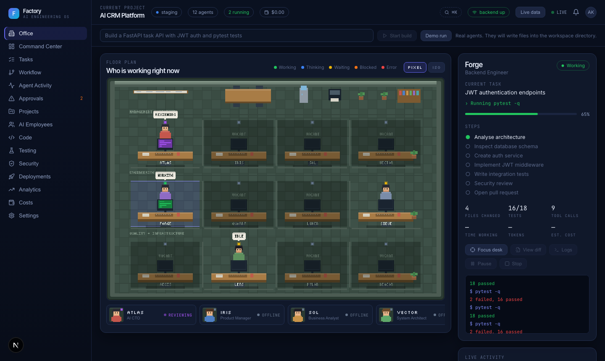

A 576×376 logical canvas scaled up with `image-rendering: pixelated`, redrawn on
a deliberate ~6fps beat — the low frame rate is what makes the typing bob and
the screen flicker read as animation frames rather than easing curves. There are
no images and no sprite sheet: every worker, desk, monitor, plant and letter is
`fillRect` calls, including a 3×5 bitmap font defined as bit strings in
[`lib/pixel.js`](frontend/lib/pixel.js).

Four desks are staffed and eight say VACANT, because four agents exist.

### The office — isometric view

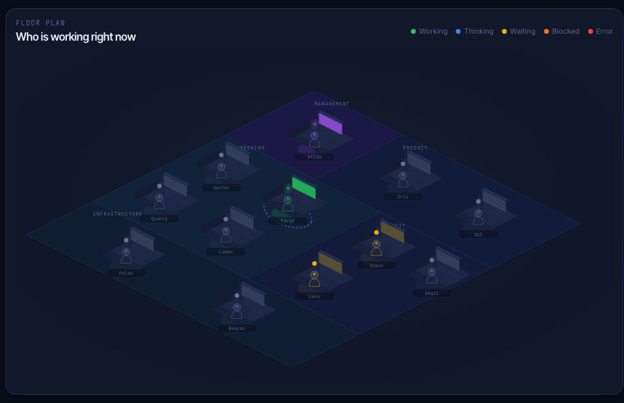

Hand-built isometric SVG: room plates, desks, monitors, seated staff, a status
marker over each head. Rooms tint when anyone in them is active. Click a desk
and the camera zooms to it.

### Agent detail panel

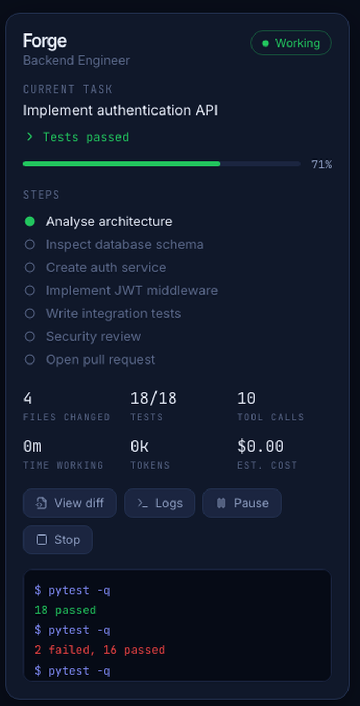

What a manager would actually ask for: current task, step, files changed, tool
calls, tests passing, tokens burned, and the raw terminal — the actual `pytest`
output, not a summary of it.

### A full run, start to finish

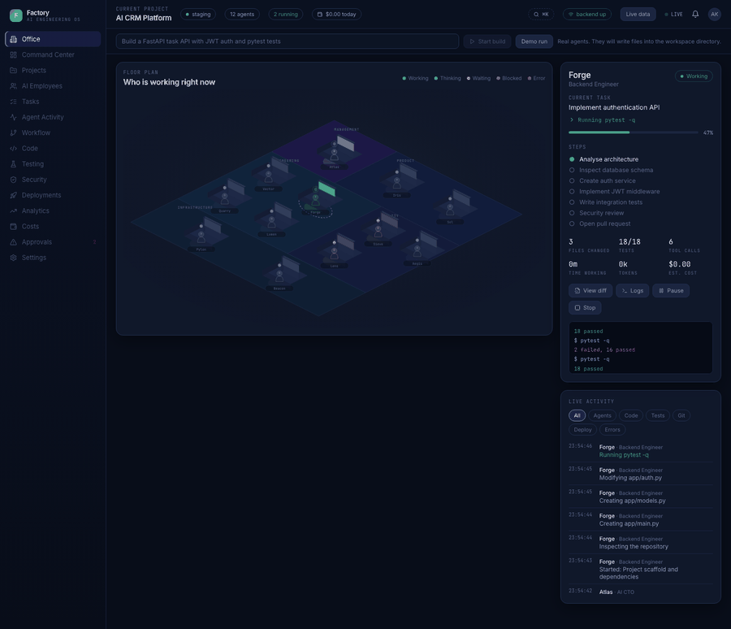

Atlas breaks the work down, Forge writes the code, the suite fails, Forge fixes
it, Sieve tests it independently, Lens reviews the diff. Nobody typed anything
after "go".

### Screens

| | |
|---|---|
| 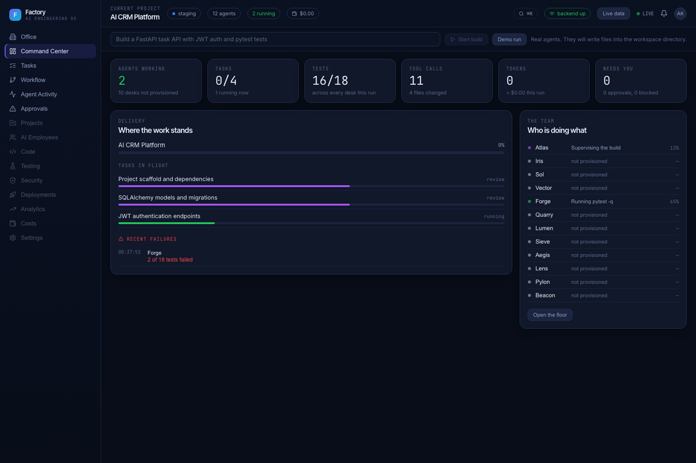 **Command Center** | 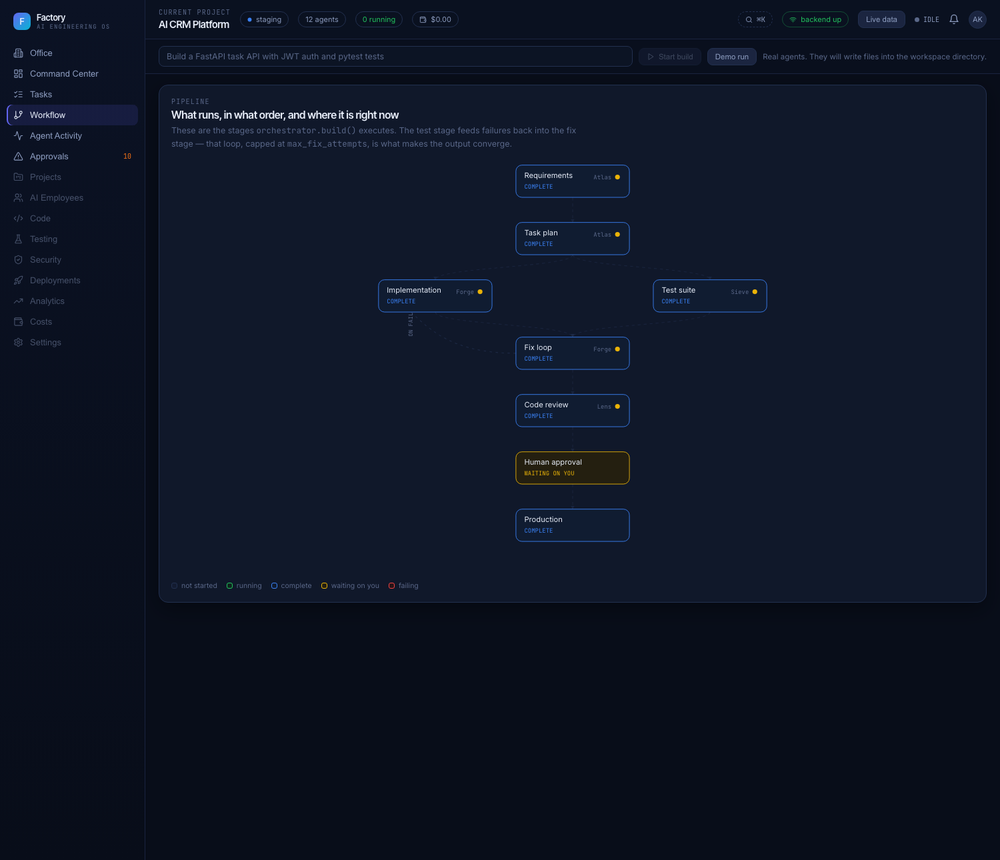 **Workflow** |
| 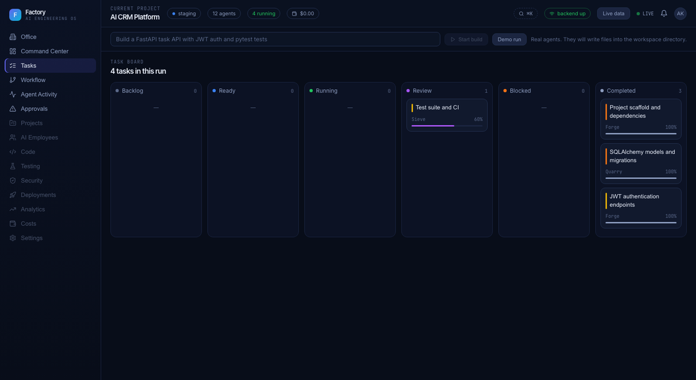 **Tasks** | 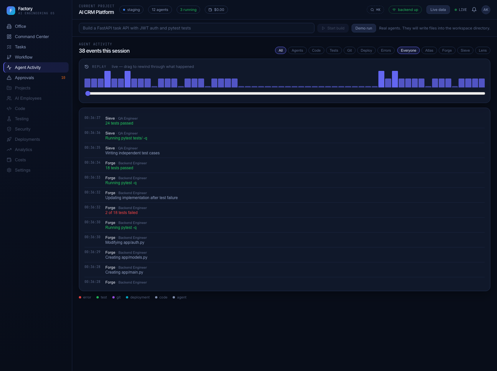 **Agent Activity** |
| 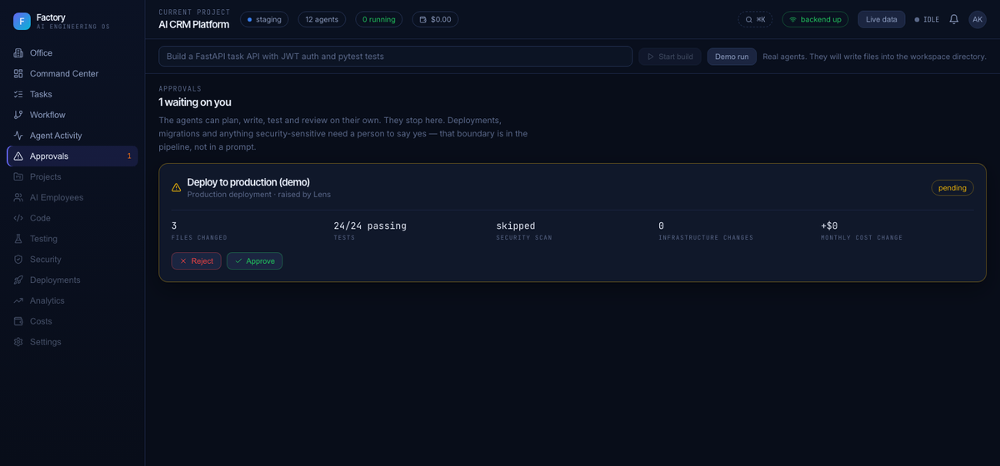 **Approvals** | 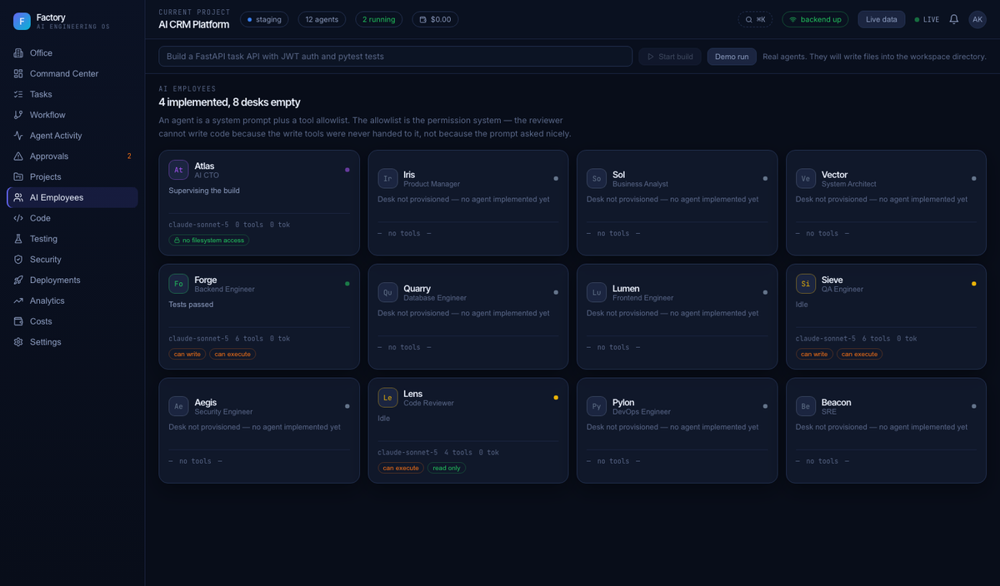 **AI Employees** |
| 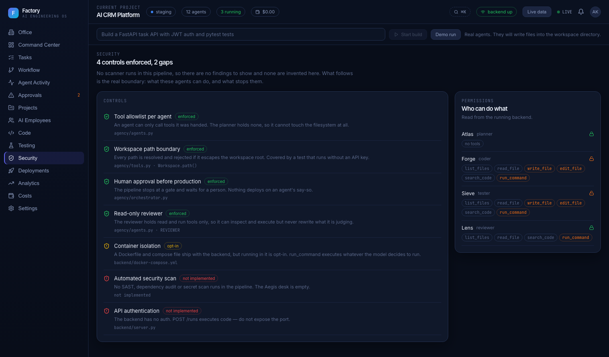 **Security** | 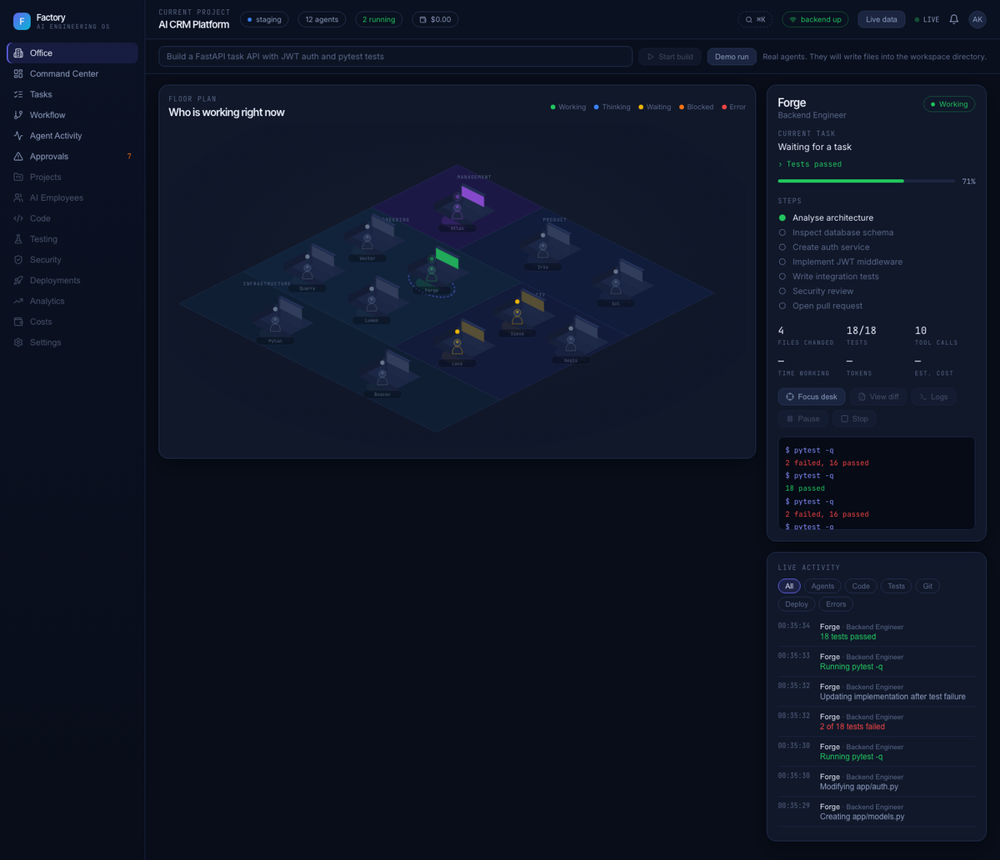 **Office** |

### Screenshots still to capture

Seven screens have no image in `docs/media/` yet. Each is reachable at the deep
link below with the app running — capture at 1600×1000 on a dark background to
match the existing set, save as `docs/media/<name>.png`, and replace the
placeholder line here.

| Screen | Deep link | Best captured when | Placeholder |
|---|---|---|---|
| Projects | `?screen=projects` | after two or three completed runs, so history has rows | **TODO:** `docs/media/projects.png` |
| Code | `?screen=code` | mid-run, after several file writes | **TODO:** `docs/media/code.png` |
| Testing | `?screen=testing` | after a failed suite followed by a passing one | **TODO:** `docs/media/testing.png` |
| Deployments | `?screen=deployments` | with a pending approval on screen | **TODO:** `docs/media/deployments.png` |
| Analytics | `?screen=analytics` | at the end of a long run, when the timeline is populated | **TODO:** `docs/media/analytics.png` |
| Costs | `?screen=costs` | at the end of a real run, when token counts are non-zero | **TODO:** `docs/media/costs.png` |
| Settings | `?screen=settings` | with the backend connected and a key present | **TODO:** `docs/media/settings.png` |

`docs/media/social-preview.png` exists and is intended as the repository's
social preview image (set under GitHub → Settings → Social preview); it is not
embedded in this document.

### What each screen shows, and where it comes from

| Screen | Route | Shows | Source of truth |
|---|---|---|---|
| **Office** | `?screen=office` (default) | Floor plan, live desk states, agent panel, terminal | `agent_update` events |
| **Command Center** | `?screen=command` | Agents working, tasks, tests, tokens, what needs you | All projections |
| **Tasks** | `?screen=tasks` | Kanban of the planner's plan | `task_update` events |
| **Workflow** | `?screen=workflow` | The pipeline as a graph, state per stage | Agents + tasks + approvals |
| **Agent Activity** | `?screen=activity` | Full log, filters, replay scrubber | The raw feed |
| **Approvals** | `?screen=approvals` | The human gate; approve or reject | `approval_*` + `POST /approvals/{id}` |
| **Projects** | `?screen=projects` | Run history: duration, events, writes, tests | `GET /runs`, rebuilt from SQLite |
| **AI Employees** | `?screen=employees` | Model, tool count, permissions per desk | `GET /agents` |
| **Code** | `?screen=code` | Files touched, per-path history | `path` metadata on file events |
| **Testing** | `?screen=testing` | Suite executions, first-run pass rate | test events |
| **Security** | `?screen=security` | The real boundary, and the gaps | `GET /agents` + architecture |
| **Deployments** | `?screen=deployments` | How far a run actually gets | Tasks + tests + approvals |
| **Analytics** | `?screen=analytics` | Events by desk, category, type, over time | The feed |
| **Costs** | `?screen=costs` | Token spend per desk, model rates | `usage` from the model |
| **Settings** | `?screen=settings` | Provider, model, whether the key is set | `GET /health` |

Press **⌘K** (or **/** when not typing) for the command palette.

> [!NOTE]
> **Three screens deliberately show less than they could.** Security shows no
> findings because no scanner runs. Deployments ends at *"nothing has ever
> shipped from here"*. Code has no diff viewer because the API does not serve
> file contents. A green tick in those places would be a lie.

---

## 8. API Documentation

Base URL in development: `http://localhost:8000`.
Interactive docs are available at `http://localhost:8000/docs` (FastAPI's
built-in Swagger UI) and `http://localhost:8000/redoc`.

### Authentication

**There is none.** No API keys, no tokens, no sessions, no per-user state. Any
client that can reach the port can start a run, and `POST /runs` executes
arbitrary shell commands via the coding agent.

> [!CAUTION]
> Do not expose port 8000 to a network you do not control. Bind to localhost, or
> put the service behind an authenticating reverse proxy, before it leaves your
> machine. Adding auth is [known limitation #7](#known-limitations).

CORS is the only access control present: `ALLOWED_ORIGINS` (default
`http://localhost:3000,http://127.0.0.1:3000,http://localhost:3001`) with all
methods and headers permitted for those origins.

### REST endpoints

#### `POST /runs` — start a build

Returns immediately. One run at a time, process-wide.

```bash
curl -X POST localhost:8000/runs \
  -H 'content-type: application/json' \
  -d '{
        "requirement": "Build a FastAPI task API with users, JWT auth and pytest tests",
        "workspace": "./workspace/task-api",
        "fix_attempts": 2
      }'
```

| Field | Type | Required | Default | Notes |
|---|---|---|---|---|
| `requirement` | string | yes | — | What to build, in plain English |
| `workspace` | string | no | `./workspace/demo` | Relative to the backend's working directory |
| `fix_attempts` | integer | no | `2` | Test→fix rounds before giving up |

```json
{ "run_id": "run-9f3a1c04", "status": "started" }
```

#### `POST /runs/demo` — scripted run

No body. No API key, no model calls, no files written. Takes about 14 seconds of
wall clock (the script has deliberate pauses).

```bash
curl -X POST localhost:8000/runs/demo
```

```json
{ "run_id": "run-9f3a1c04", "status": "started" }
```

#### `POST /approvals/{approval_id}` — answer a gate

```bash
curl -X POST localhost:8000/approvals/ap-4b21d0e7 \
  -H 'content-type: application/json' \
  -d '{"decision": "approved", "note": "diff looks clean"}'
```

| Field | Type | Required | Allowed values |
|---|---|---|---|
| `decision` | string | yes | `approved` · `rejected` |
| `note` | string | no | free text |

```json
{ "id": "ap-4b21d0e7", "status": "approved" }
```

Emits an `approval_resolved` event plus an `activity` event, both of which reach
every connected socket.

#### `GET /health` — provider, model, key presence

```bash
curl localhost:8000/health
```

```json
{
  "status": "ok",
  "provider": "anthropic",
  "model": "claude-sonnet-5",
  "api_key_present": true,
  "api_key_env_var": "ANTHROPIC_API_KEY",
  "running": false
}
```

#### `GET /agents` — who exists and exactly what they may do

Read from the same objects the runtime uses, not a description of them.

```bash
curl localhost:8000/agents
```

```json
{
  "agents": [
    { "name": "planner",  "deskId": "cto",      "model": "claude-sonnet-5",
      "maxTurns": 50, "tools": [], "canWrite": false, "canExecute": false },
    { "name": "coder",    "deskId": "backend",  "model": "claude-sonnet-5",
      "maxTurns": 50,
      "tools": ["list_files","read_file","write_file","edit_file","search_code","run_command"],
      "canWrite": true, "canExecute": true },
    { "name": "tester",   "deskId": "qa",       "model": "claude-sonnet-5",
      "maxTurns": 50,
      "tools": ["list_files","read_file","write_file","edit_file","search_code","run_command"],
      "canWrite": true, "canExecute": true },
    { "name": "reviewer", "deskId": "reviewer", "model": "claude-sonnet-5",
      "maxTurns": 50,
      "tools": ["list_files","read_file","search_code","run_command"],
      "canWrite": false, "canExecute": true }
  ]
}
```

#### `GET /runs` — run history

Reconstructed by aggregating the event log, so it survives restarts.

```json
{
  "runs": [
    { "runId": "run-9f3a1c04", "startedAt": "2026-08-31T10:04:11.220+00:00",
      "endedAt": "2026-08-31T10:11:47.905+00:00", "events": 412, "agents": 4,
      "testsPassed": 3, "testsFailed": 1, "fileWrites": 37, "current": true }
  ],
  "current": "run-9f3a1c04"
}
```

Capped at 50 runs, newest first.

#### `GET /state` — snapshot for first paint

```json
{
  "run_id": "run-9f3a1c04",
  "running": true,
  "agents":   { "backend": { "id": "backend", "status": "working", "currentActivity": "Creating app/main.py", "filesChanged": 3, "toolCalls": 11 } },
  "tasks":    { "t1": { "id": "t1", "title": "Project scaffold", "status": "running", "assignedAgentId": "backend", "progress": 25, "priority": "high" } },
  "approvals":{ },
  "events":   [ { "kind": "activity", "payload": { }, "ts": "…", "run_id": "run-9f3a1c04" } ]
}
```

`events` holds the last 200 events of the current run, oldest first.

#### `GET /` — fallback UI

Serves [`backend/static/index.html`](backend/static/index.html): a
dependency-free page with a requirement box, a Web Speech mic button (Chrome
only) and a live feed. Useful when you don't want to run Node.

### WebSocket `/stream`

```bash
npx wscat -c ws://localhost:8000/stream
```

On connect the server **replays the last 120 events of the current run**, then
streams live. That is why [`useRealtime.js`](frontend/lib/useRealtime.js)
dedupes on `payload.id` — without it, a dropped connection silently duplicates
the entire feed.

Every frame is JSON with the same envelope:

```json
{ "kind": "activity", "payload": { }, "ts": "2026-08-31T10:04:11.220+00:00", "run_id": "run-9f3a1c04" }
```

### Event shapes

| `kind` | Emitted by | Key payload fields |
|---|---|---|
| `activity` | `activity()` in `events.py` | `id`, `timestamp`, `agentId`, `taskId`, `type`, `category`, `message`, `metadata` |
| `agent_update` | `agent_update()` | `id` (desk id), plus any of `status`, `currentActivity`, `progress`, `filesChanged`, `toolCalls`, `testsPassed`, `testsTotal`, `inputTokens`, `outputTokens`, `currentTaskId` — **partial updates merge** into the projection |
| `task_update` | `orchestrator.py`, `demo.py` | `id`, `title`, `status`, `assignedAgentId`, `progress`, `priority` |
| `approval_requested` | `orchestrator.py`, `demo.py` | `id`, `type`, `title`, `requestedByAgentId`, `status`, `summary` |
| `approval_resolved` | `POST /approvals/{id}` | `id`, `status`, `note`, `resolvedBy` |

`activity.type` values: `task_assigned`, `task_started`, `task_completed`,
`task_failed`, `task_blocked`, `tool_called`, `file_read`, `file_created`,
`file_modified`, `search_performed`, `test_started`, `test_passed`,
`test_failed`, `review_submitted`, `approval_granted`, `approval_rejected`.

`activity.category` values: `agent`, `code`, `test`, `git`, `deployment`,
`error`.

`agent_update.status` values: `working`, `thinking`, `reviewing`, `waiting`,
`blocked`, `error`, `offline`.

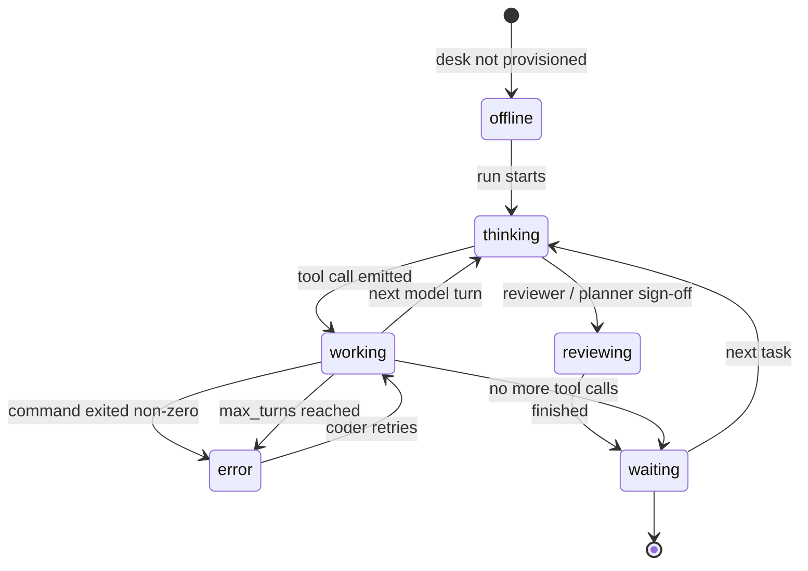

The full contract, as TypeScript types, is in
[`frontend/lib/types.ts`](frontend/lib/types.ts). Mirror it when you add a
backend field.

> [!IMPORTANT]
> No event carries model reasoning. `ActivityEventType` in `types.ts` says so
> explicitly: *"If you find yourself wanting a `reasoning` field here, that is
> the signal you are about to leak chain-of-thought into the UI."*

### Error responses

The API returns HTTP **200** with an `error` key in the body for expected
failures, rather than 4xx status codes:

| Situation | Response |
|---|---|
| A run is already in progress | `{"error": "a run is already in progress", "run_id": "run-…"}` |
| Unknown approval id | `{"error": "no approval ap-xxxx"}` |
| Bad decision value | `{"error": "decision must be 'approved' or 'rejected'"}` |
| Malformed request body | FastAPI/Pydantic **422** with a `detail` array |
| A run raises after starting | HTTP 200 was already returned; the failure arrives as an `activity` event with `type: "task_failed"`, `category: "error"` and message `"Run failed: <ExceptionType>: <message>"` |
| No API key for the selected provider | The run thread raises `MissingAPIKey`, surfaced as the `task_failed` activity event above |

> [!NOTE]
> **TODO:** the `{"error": ...}` + HTTP 200 pattern is inconsistent with the 422
> Pydantic returns. Moving these to proper 409 / 404 / 400 status codes would be
> a clean, self-contained contribution — but it is a breaking change for
> `useRealtime.js`, which reads `r?.error` off the parsed body.

### Rate limits

**None are implemented.** There is no throttling, quota or backpressure on any
endpoint. The only concurrency control is the process-wide run lock, which makes
a second `POST /runs` return an error rather than queue.

Upstream provider rate limits still apply and surface as exceptions from the
model client, which reach the UI as a `task_failed` activity event.

---

## 9. Database

SQLite, via Python's stdlib `sqlite3`. No server, no ORM, no connection string.

The file is `agency.db`, created **relative to the process's working
directory** — run uvicorn from `backend/` and it lands at `backend/agency.db`.
It is git-ignored (`*.db`).

### Schema

One table and one index, in [`agency/events.py`](backend/agency/events.py):

```sql
CREATE TABLE IF NOT EXISTS agent_events (
    id          TEXT PRIMARY KEY,   -- uuid4 hex, per event
    ts          TEXT NOT NULL,      -- ISO-8601 UTC
    run_id      TEXT NOT NULL,      -- "run-" + 8 hex chars, one per process
    agent_id    TEXT NOT NULL,      -- desk id, or "system"
    task_id     TEXT,               -- e.g. "t3", when the event belongs to a task
    kind        TEXT NOT NULL,      -- activity | agent_update | task_update | approval_*
    type        TEXT,               -- file_created, test_passed, …
    category    TEXT,               -- agent | code | test | git | deployment | error
    message     TEXT,               -- the rendered phrase, from TOOL_EVENTS
    payload     TEXT NOT NULL       -- the full JSON envelope, verbatim
);

CREATE INDEX IF NOT EXISTS idx_events_run ON agent_events(run_id, ts);
```

That is the entire persistent schema. **There is no `agents` table, no `tasks`
table, no `files` table and no `test_runs` table.** Agents, tasks, approvals,
files, test runs, analytics and costs are all *projections*:

- **Server-side**, folded into `bus.snapshot` / `bus.tasks` / `bus.approvals`
  as events are emitted (in memory only — they reset on restart, which is why
  `/state` looks sparse right after a backend restart even though SQLite still
  has everything).
- **Client-side**, in [`lib/derive.js`](frontend/lib/derive.js) and
  `useDerivedMetrics` in [`lib/useRealtime.js`](frontend/lib/useRealtime.js).

The denormalised columns (`agent_id`, `type`, `category`, `message`) exist only
so `GET /runs` can aggregate with SQL instead of parsing every `payload`.

### ER diagram

There is one physical table. The diagram below shows the *logical* entities the
log encodes, which is what you would build real tables for if you moved to
Postgres:

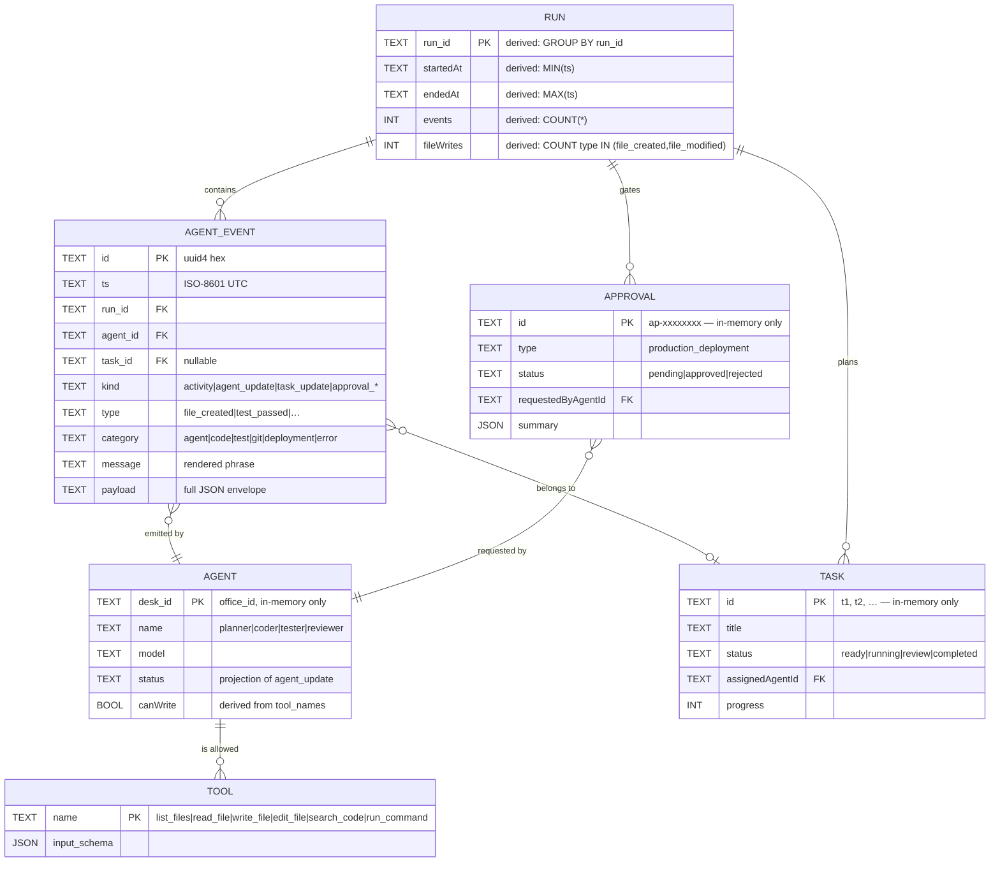

> [!NOTE]
> Entities marked *in-memory only* live in `bus.snapshot`, `bus.tasks` and
> `bus.approvals`. They are rebuilt from events at emit time, not at startup —
> so a restart empties them while the event log stays intact. Rebuilding
> projections from SQLite on boot is a small, well-scoped contribution.

### Migrations

**There is no migration system.** `EventBus.__init__` runs the `SCHEMA` script
above through `executescript()` on every construction, and every statement is
`IF NOT EXISTS`, so the schema is created idempotently at import time.

That is adequate because the schema is append-only and has never changed. If you
change it:

1. Adding a **nullable column** is safe — add it to `SCHEMA`, add an
   `ALTER TABLE … ADD COLUMN` guarded by a `PRAGMA table_info` check, and update
   the `INSERT` in `emit()`.
2. Anything else — renames, type changes, constraints — needs a real migration
   tool. **TODO:** adopt Alembic (or plain numbered `.sql` files applied by a
   `schema_version` table) at that point.

To reset the database completely:

```bash
rm backend/agency.db
```

That deletes run history. It does not touch anything the agents built in
`backend/workspace/`.

### Seeding

**There is no seed script and no fixture data.** The equivalent is the demo run,
which writes a realistic 17-step run into the same table through the same code
path a real run uses:

```bash
# via the API
curl -X POST localhost:8000/runs/demo

# or from the CLI, with no server
cd backend && python run.py --demo
```

The frontend has its own, entirely separate stand-in: `MOCK_TASKS`,
`MOCK_APPROVALS`, `MOCK_RUNS` and `MOCK_ROSTER` in
[`lib/mockEngine.js`](frontend/lib/mockEngine.js). That data never touches the
database — it exists so the UI is never a blank screen — and the top bar always
says which source you are looking at.

---

## 10. Configuration

### Configuration files

| File | Scope | What it controls |
|---|---|---|
| [`backend/requirements.txt`](backend/requirements.txt) | backend | Python dependencies and their minimum versions |
| [`backend/Dockerfile`](backend/Dockerfile) | backend | `python:3.12-slim`, `git`/`curl`/`build-essential`, unprivileged `agent` user, `ENTRYPOINT ["python", "run.py"]` |
| [`backend/docker-compose.yml`](backend/docker-compose.yml) | backend | Service `agency`; passes `ANTHROPIC_API_KEY` and `AGENT_MODEL`; mounts `./workspace`; `mem_limit: 2g`, `cpus: 2.0` |
| [`frontend/package.json`](frontend/package.json) | frontend | Dependencies and the four npm scripts |
| [`frontend/next.config.mjs`](frontend/next.config.mjs) | frontend | `reactStrictMode: true` — nothing else |
| [`frontend/tsconfig.json`](frontend/tsconfig.json) | frontend | `strict: true`, `allowJs: true`, `checkJs: false`, `@/*` path alias. Types cover `lib/types.ts`; the app itself is JSX. |
| [`frontend/vercel.json`](frontend/vercel.json) | deploy | Sets `NEXT_PUBLIC_API_URL: ""` for the hosted build, so the deployed demo runs simulation-only instead of retrying a socket that will never be there |
| [`frontend/.env.local.example`](frontend/.env.local.example) | frontend | Template for `.env.local` |
| [`.claude/launch.json`](.claude/launch.json) | tooling | Dev-server definition (`office-ui`, `npm run dev`, port 3000) for the Claude Code preview pane |
| [`.claude/settings.local.json`](.claude/settings.local.json) | tooling | Locally allowed shell commands for Claude Code |
| [`.gitignore`](.gitignore) | repo | Virtualenvs, `__pycache__`, `node_modules`, `.next`, `*.db`, `backend/workspace/`, `.env*`, `.vercel` |

### Environment variables

See the [full table in Installation](#environment-variables). In short:

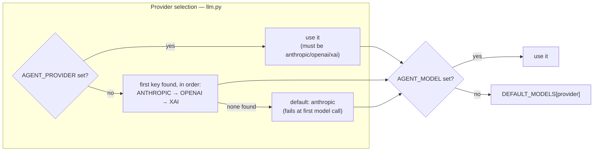

### Feature flags

There is no flag framework. Four switches exist, and all of them are runtime UI
state or function arguments rather than configuration:

| Switch | Where | Default | Effect |
|---|---|---|---|
| **Live data / Demo data** | Top-bar button in [`Shell.jsx`](frontend/components/Shell.jsx); also ⌘K | flips to Live automatically the moment the socket connects | Chooses whether every screen reads `useRealtime` or `useOfficeEngine` |
| **Pixel / Iso** | Toggle on the Office screen | `pixel` | Which floor renderer draws the office |
| **Pause floor / Resume floor** | Top bar, only visible in Demo mode | running | Stops the simulation's timers |
| **`fix_attempts`** | `POST /runs` body, `--fix-attempts` on the CLI | `2` | How many test→fix rounds before the pipeline moves on to review |

Two constants behave like tuning knobs and are edited in code:

| Constant | File | Default | Effect |
|---|---|---|---|
| `MAX_TOKENS` | `agency/runtime.py` | `16000` | Per-turn output ceiling. High enough that a coder turn is not cut mid-edit, low enough to stay under the SDK's HTTP timeout. |
| `Agent.max_turns` | `agency/runtime.py` | `50` | Tool-loop iterations before an agent gives up with `STOPPED: max_turns reached` |
| `MAX_OUTPUT` | `agency/tools.py` | `8000` | Characters of tool output before truncation |
| `SKIP_DIRS` | `agency/tools.py` | `.git`, `node_modules`, `__pycache__`, `.venv`, `dist`, `build` | Directories `list_files` and `search_code` ignore |
| `PRICES` | `agency/llm.py` | see file | USD per million tokens, used for the cost estimate |

---

## 11. Development Guide

### Learn this codebase in eight steps

About 900 lines of backend, meant to be read in one sitting. Each step says what
to look for and gives you something to try.

**Step 1 — The tools** ([`agency/tools.py`](backend/agency/tools.py))

Six functions, one class, no cleverness.

```python
class Workspace:
    def path(self, rel: str) -> Path:
        p = (self.root / rel).resolve()
        if p != self.root and self.root not in p.parents:
            raise ValueError(f"path escapes workspace: {rel}")
        return p
```

*Notice:* that is the entire sandbox. Every tool resolves through it, so
`../../../etc/passwd` fails in one place rather than six.
*Try:* `python test_tools.py` — runs without a key and asserts the boundary holds.

**Step 2 — The agent loop** ([`agency/runtime.py`](backend/agency/runtime.py))

*Notice:* an agent is not a framework, it is a while-loop. Also read
`_report_command_result` — it parses `18 passed` out of pytest output and turns
it into a structured test event, which is how the UI knows tests passed without
asking the model to self-report.

**Step 3 — The agents** ([`agency/agents.py`](backend/agency/agents.py))

*Notice — the most important idea in the repo:* the reviewer **cannot** write
code. Not because the prompt asks it not to, but because `write_file` was never
handed to it. The tool allowlist is the permission system. Open the Security
screen to see this rendered live from the same objects.

**Step 4 — The orchestrator** ([`agency/orchestrator.py`](backend/agency/orchestrator.py))

*Notice:* the fix loop. The tester's report becomes the coder's next input, and
the cap is what stops it looping forever.

**Step 5 — The event bus** ([`agency/events.py`](backend/agency/events.py))

*Notice:* three things happen per event — fold into memory, append to SQLite,
fan out to sockets. Event sourcing in about 40 lines.

**Step 6 — The bridge** ([`backend/server.py`](backend/server.py))

*Notice:* `_start()` and the `/stream` handler. The socket replays history
before going live, and a run holds a lock, because two concurrent runs would
interleave into one office.

**Step 7 — The client projection** ([`lib/useRealtime.js`](frontend/lib/useRealtime.js))

*Notice:* the dedupe. The server replays on every connect; without it, a dropped
connection duplicates the entire feed. That bug was found by watching React warn
about duplicate keys.

**Step 8 — The screens** ([`components/screens/`](frontend/components/screens))

Read [`lib/derive.js`](frontend/lib/derive.js) first. There is no `files` table
and no `test_runs` table on the backend — the Code screen is `useFiles(feed)`,
the Testing screen is `useTestRuns(feed)`. Because they are derived from the
same log the office renders, no two screens can disagree.

**Exercises, in increasing difficulty**

1. **Trace one event end to end.** Add `print(msg)` in `EventBus.emit`, start a
   demo run, and watch the same object appear in the terminal, in `agency.db`,
   and in the browser feed.
2. **Break the sandbox on purpose.** Ask the coder to write to `/tmp/x`. Watch
   it get refused, and watch the agent recover.
3. **Give the reviewer `write_file`.** Observe that the prompt no longer controls
   its behaviour. Then take it away again.
4. **Add a seventh tool** and see it appear in the activity feed without
   touching the UI.
5. **Make the planner drift.** Run a large requirement and watch task 4
   contradict task 2. That is [limitation #2](#known-limitations), and fixing it
   is the most valuable thing you could build here.

### Coding standards

There is no enforced style config in the repository, so these are the
conventions the existing code follows. Match them.

**Python**

- 4-space indent, ~100-column soft limit, `snake_case`.
- `from __future__ import annotations` at the top of every module in `agency/`.
- Type hints on public functions. `dataclasses` for records (`Agent`, `Usage`,
  `Result`), plain dicts for event payloads.
- **Module docstrings explain the *why*, not the *what*.** Every file in
  `agency/` opens with one, and several name the specific failure the design
  avoids. Keep that up — it is the reason the codebase is readable.
- Tools return **strings**, never raise, and prefix failures with `ERROR: ` so
  the model sees the error and can recover instead of crashing the run.
- Never add a field that could carry model reasoning to an event payload.

**JavaScript / JSX**

- 2-space indent, double quotes, semicolons, `camelCase`.
- `"use client"` on every component that uses hooks, state or the DOM.
- Styling is inline `style={{}}` objects plus the `vo-*` class names defined in
  [`globals.css`](frontend/app/globals.css). There is no CSS-in-JS library and
  no utility framework — do not introduce one.
- Colours come from `C` and `STATUS` in [`theme.js`](frontend/lib/theme.js).
  Never hard-code a hex value in a component.
- Derived data goes in a hook in [`derive.js`](frontend/lib/derive.js), not in
  component state. Screens read the feed; they do not keep their own copy of it.
- `lucide-react` is the only icon source.

**Cross-cutting**

- Desk ids in [`roster.js`](frontend/lib/roster.js) **must** match `office_id`
  in [`agents.py`](backend/agency/agents.py), or `useRealtime` drops the event
  (`if (!DESKS.includes(id)) return;`).
- The wire format is `camelCase`. `types.ts` documents the intent to convert
  snake_case at one boundary; today the backend already emits camelCase in
  payloads, so no conversion layer exists.

### Linting and formatting

| Tool | Status |
|---|---|
| ESLint | `npm run lint` runs `next lint`, but **no `.eslintrc*` or `eslint.config.*` is committed** — the first run stops on an interactive prompt, so it cannot run in CI as-is. It also warns that `next lint` is deprecated and will be removed in Next.js 16. **TODO:** migrate to the ESLint CLI (`npx @next/codemod@canary next-lint-to-eslint-cli .`) and commit the config — Next's `strict` preset is the obvious choice. |
| Prettier | Not configured. **TODO** if you want automatic formatting. |
| Ruff / Black / flake8 | Not configured for the backend. **TODO.** |
| EditorConfig | Not present. **TODO.** |

Until those land, formatting is by hand against the conventions above.

### Testing

| Suite | Command | Needs a key | Covers |
|---|---|---|---|
| Tool layer | `cd backend && python test_tools.py` | no | `write_file`, `read_file`, `list_files`, `search_code`, `edit_file` (including both error paths), `run_command`, and **the sandbox boundary** — that `../../../etc/passwd` and `/tmp/escape` are both refused |
| Wiring, end to end | `python run.py --demo` or `curl -X POST localhost:8000/runs/demo` | no | Event bus → SQLite → WebSocket → every UI screen |
| Frontend | — | — | **TODO:** there are no frontend tests. No Jest, Vitest, Testing Library or Playwright is configured. |

`test_tools.py` is a plain script with `assert` statements and a `main()`, not a
pytest suite — it runs under `python`, not `pytest`. Adding real pytest coverage
for `events.py` (projection folding, replay, dedupe) and `orchestrator.py`
(`_normalise` against malformed planner output) would be a high-value
contribution; both are pure functions over data and need no API key.

### Build process

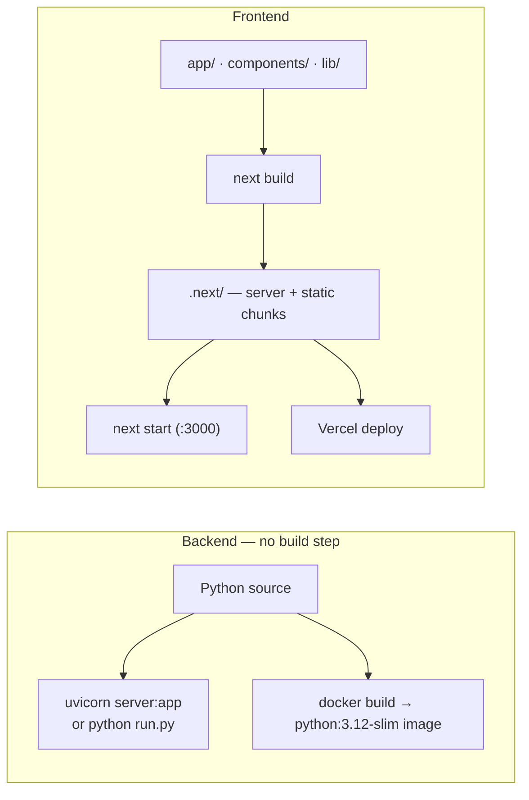

The backend has **no build step** — it runs from source. The only artefact is
the Docker image.

The frontend build inlines `NEXT_PUBLIC_API_URL` into the bundle, so changing
which backend the UI talks to requires a rebuild, not a restart.

### Debugging tips

| Symptom to investigate | How |
|---|---|
| **Is the event actually being emitted?** | Add `print(msg)` at the top of `EventBus.emit`. Every event crosses that one line. |
| **What did the agent really do?** | `sqlite3 backend/agency.db "SELECT ts, agent_id, type, message FROM agent_events ORDER BY ts DESC LIMIT 40;"` |
| **What did one run cost?** | `cat <workspace>/.agency/run.jsonl` — one JSON line per stage with tokens, turns, seconds and the stage summary. |
| **What plan did the planner produce?** | `cat <workspace>/.agency/plan.json` |
| **Is the socket delivering?** | `npx wscat -c ws://localhost:8000/stream` — you get the replay immediately, then live frames. |
| **Is it the socket or the UI?** | Compare `curl localhost:8000/state` against what the screen shows. If `/state` has the data and the screen doesn't, the bug is in `useRealtime` or a desk-id mismatch. |
| **Which provider/model is live?** | `curl localhost:8000/health`, or open the Settings screen. |
| **Are the agents' permissions what you think?** | `curl localhost:8000/agents`, or open the Security screen. |
| **The agent loop's own trace** | `run_agent(..., verbose=True)` is the default: it prints each model reply and every `tool_name(args)` to stdout. Watch the uvicorn terminal during a run. |
| **A desk never lights up** | Its `office_id` in `agents.py` is not in `DESKS` in `roster.js`. `useRealtime` drops those events silently, by design. |
| **The feed duplicates on reconnect** | The dedupe key is `payload.id`. Any new event source must set a unique `id`, or it will be re-added on every replay. |
| **React hydration mismatch** | Something random or time-dependent rendered on the server. `Shell` is loaded with `ssr: false` for exactly this reason; the simulation uses the deterministic `spread()` helper rather than `Math.random()` for initial state. |

### Extending the system

**Add a tool**

1. Write the function in [`tools.py`](backend/agency/tools.py) — it takes
   `(ws, **kwargs)` and returns a string.
2. Add its JSON schema to `SCHEMAS` and the function to `IMPLS`.
3. Add its name to an agent's `tool_names` in
   [`agents.py`](backend/agency/agents.py).
4. *Optional:* add a row to `TOOL_EVENTS` in
   [`events.py`](backend/agency/events.py) so the UI phrases it nicely.

Skip step 4 and it still works — it shows as *"Calling your_tool"*.

**Add an agent**

1. Define it in `agents.py`: system prompt + `tool_names` + `office_id` (which
   desk it sits at — must exist in `roster.js`).
2. Call it from `orchestrator.py` at the right point in the pipeline.
3. Add it to the `defined` list in `list_agents()` in
   [`server.py`](backend/server.py) so `GET /agents` reports it.

The UI already has twelve desks and will light up the matching one. The empty
desks are `architect`, `database`, `frontend`, `security`, `devops`, `sre`,
`pm`, `analyst`. **Start with the architect** — see
[known limitations](#known-limitations).

**Add a screen**

1. Create `frontend/components/screens/YourScreen.jsx`.
2. Add a `NAV` entry and a `case` in [`Shell.jsx`](frontend/components/Shell.jsx).
3. Derive what you need from `feed` by adding a hook to
   [`derive.js`](frontend/lib/derive.js) rather than introducing new state.

**Change the model**

```bash
export AGENT_MODEL=claude-opus-5      # anything your provider serves
export AGENT_PROVIDER=openai          # force a provider
```

Restart the backend — both are read at import. Rates for the cost estimate live
in `PRICES` in [`llm.py`](backend/agency/llm.py).

---

## 12. Deployment

### What is deployed today

| Component | Target | How |
|---|---|---|
| Frontend | Vercel — [ai-software-factory-qadir-khan.vercel.app](https://ai-software-factory-qadir-khan.vercel.app) | Project `ai-software-factory`, linked in `.vercel/project.json`. `frontend/vercel.json` sets `NEXT_PUBLIC_API_URL: ""` at build, so the hosted build runs the **simulation only** and never opens a socket. |
| Backend | Not deployed anywhere | It executes arbitrary shell commands and has no authentication. See the warning below. |

### Build commands

```bash
# frontend
cd frontend
npm ci                 # reproducible install from package-lock.json
npm run build          # → .next/
npm run start          # serve the production build

# backend image
docker build -t ai-factory-backend backend
```

Vercel picks up the Next.js defaults; the only project-specific setting is the
build-time env var in `vercel.json`. To deploy a build that talks to a real
backend, set `NEXT_PUBLIC_API_URL` in the Vercel project settings (which
overrides `vercel.json`) and set `ALLOWED_ORIGINS` on the backend to that
Vercel origin.

> [!CAUTION]
> **Do not deploy the backend to a public host as-is.** `POST /runs` is
> unauthenticated and the coding agent runs shell commands. If you must host it:
> run it in the container, put it behind an authenticating proxy, bind it to a
> private network, and give the container no credentials you care about.

### CI/CD workflow

**There is none.** No `.github/workflows/`, no GitLab CI, no CircleCI config
exists in the repository. Vercel's own Git integration is the only automation:
a push to `main` triggers a frontend preview/production build.

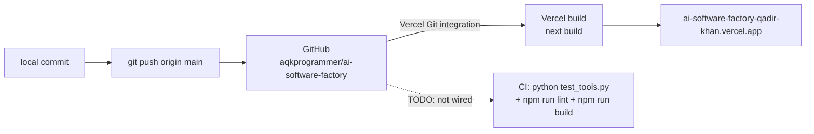

**TODO — the CI pipeline that should exist.** A single workflow covering the
three checks that are already runnable:

```yaml
# .github/workflows/ci.yml — TODO: not present in the repository
name: ci
on: [push, pull_request]
jobs:
  backend:
    runs-on: ubuntu-latest
    steps:
      - uses: actions/checkout@v4
      - uses: actions/setup-python@v5
        with: { python-version: "3.12" }
      - run: pip install -r backend/requirements.txt
      - run: python test_tools.py
        working-directory: backend
  frontend:
    runs-on: ubuntu-latest
    steps:
      - uses: actions/checkout@v4
      - uses: actions/setup-node@v4
        with: { node-version: "20", cache: npm, cache-dependency-path: frontend/package-lock.json }
      - run: npm ci
        working-directory: frontend
      - run: npm run build
        working-directory: frontend
```

### Release process

**TODO — no release process is defined.** There are no git tags, no
`CHANGELOG.md`, and no GitHub releases. The current process is: commit to
`main`, Vercel deploys the frontend.

### Versioning

| Artefact | Version | Notes |
|---|---|---|
| `frontend/package.json` | `0.1.0` | `private: true`, never published to npm |
| Backend | unversioned | No `pyproject.toml`, no `__version__`, no tags |
| Repository | unversioned | No tags, no releases |

**TODO:** adopt semantic versioning with git tags (`v0.2.0`) and a
`CHANGELOG.md` if this becomes something people depend on.

---

## 13. Troubleshooting

### Common issues

| Symptom | Cause | Fix |
|---|---|---|
| `backend down` in the top bar | Server not running, or on a different port | Start uvicorn; check `NEXT_PUBLIC_API_URL` in `frontend/.env.local` |
| `address already in use` on :8000 | Something is already on the port | `lsof -nP -iTCP:8000 -sTCP:LISTEN -t \| xargs kill` |
| Run fails instantly, feed shows `Run failed: MissingAPIKey` | No key exported in the shell that started uvicorn | `export ANTHROPIC_API_KEY=...`, then **restart the backend** — the provider is read at import |
| `{"error": "a run is already in progress"}` | The process-wide run lock is held | Wait for it, or restart the backend. One run at a time is deliberate. |
| Everything looks busy but nothing is real | You are in **Demo data** mode | Toggle **Live data** in the top bar (it flips automatically once the socket connects) |
| **Start build** button is disabled | It requires both a non-empty requirement and `wire.connected` | Start the backend |
| `AGENT_PROVIDER must be one of ('anthropic', 'openai', 'xai')` at import | A typo in the env var | Fix the value and restart |
| `provider openai needs the openai package` | `AGENT_PROVIDER=openai` without the dependency | `pip install openai` (it is already in `requirements.txt`) |
| Screens empty after a backend restart | Projections (`bus.snapshot`, `bus.tasks`) live in memory and are not rebuilt from SQLite on boot | Run again. The event log itself is intact — `GET /runs` still shows history. |
| A new agent's desk never lights up | Its `office_id` is not in `DESKS` in `roster.js` | Add the desk to `roster.js`, or reuse an existing id |
| Duplicate rows in the activity feed | An event source that does not set a unique `payload.id` | Give every emitted activity a `uuid4().hex` id, as `activity()` does |
| `Cannot find module './447.js'` or similar | Stale Next.js build cache | `rm -rf frontend/.next` and restart `npm run dev` |
| React hydration mismatch warnings | Something time- or random-dependent rendered on the server | The app already loads `Shell` with `ssr: false`; if you added a component outside it, move it inside |
| `next lint` asks you to configure ESLint | No ESLint config is committed | Accept the prompt, or add a config — see [Linting](#linting-and-formatting) |
| Agent writes nothing and stops early | It hit `max_turns` (50) | Look for `STOPPED: max_turns reached` in the stage summary in `.agency/run.jsonl`; raise `max_turns` or narrow the task |
| Tool output looks cut off | `MAX_OUTPUT` truncates at 8000 chars | Expected. The truncation is marked inline in the tool result. |
| `command timed out after 300s` | A shell command exceeded `run_command`'s timeout | Expected. The agent sees the error and can retry with something smaller. |

**Reset everything:**

```bash
rm backend/agency.db              # deletes run history, not code
rm -rf backend/workspace/*        # deletes what the agents built
rm -rf frontend/.next             # clears the build cache
```

### Known limitations

Written down honestly, because a demo that hides its edges is not worth showing.
These are the project's open problems, in roughly the order you will hit them.

1. **Context.** The coder re-reads files every task and burns tokens. *Fix:* a
   compact repo map plus a summary of what previous tasks changed. This is the
   single largest avoidable cost.
2. **Drift.** Task 4 can contradict task 2. *Fix:* an **architect agent** that
   writes `ARCHITECTURE.md` and API contracts once, which every coder task then
   reads. **This is the highest-value thing to build next.**
3. **Crash recovery.** A failed run loses its state; projections are in memory
   and are not rebuilt from SQLite on boot. *Fix:* persist task state and make
   runs resumable. This is where a durable workflow engine starts paying for
   itself — not before.
4. **One process.** Two concurrent runs would interleave into one office, which
   is why the run lock exists. The `run_id` column is already in the schema; the
   socket needs to filter on it, and `_fanout` needs to become Redis pub/sub.
5. **SQLite writes on every tool call.** Fine for one run, not for ten. Move to
   Postgres when you notice it, not before.
6. **Git.** Agents mutate the workspace directly. *Fix:* branch per task, PR per
   task, reviewer comments on a real diff.
7. **No auth on the API.** `POST /runs` executes code. Do not expose the port.
8. **Eight empty desks.** `architect`, `database`, `frontend`, `security`,
   `devops`, `sre`, `pm` and `analyst` are roster entries, not implementations.
   They render as `offline` on purpose — a fake-busy desk teaches you nothing.
9. **No security scanning, no deployment.** The Security screen reports the
   controls that genuinely exist and names the gaps; the Deployments screen ends
   at *"nothing has ever shipped from here"*. Both are accurate.
10. **No frontend tests, no CI.** See [Testing](#testing) and
    [CI/CD](#cicd-workflow).
11. **Windows is untested.** `run_command` uses `shell=True` and `search_code`
    shells out to `grep`. Use WSL2.

---

## 14. Contributing

Issues are open, and the ones labelled
[`good first issue`](https://github.com/aqkprogrammer/ai-software-factory/labels/good%20first%20issue)
are real gaps rather than busywork — each one is a limitation named above.

### Branch strategy

`main` is the only long-lived branch and is what Vercel deploys. Work on a
short-lived branch off `main` and open a pull request.

```
main
 ├── feat/architect-agent
 ├── fix/reconnect-dedupe
 └── docs/api-error-codes
```

Suggested prefixes: `feat/`, `fix/`, `docs/`, `refactor/`, `test/`, `chore/`.

> [!NOTE]
> **TODO:** no branch protection, `CONTRIBUTING.md`, `CODE_OF_CONDUCT.md` or PR
> template exists in the repository. The conventions below are the ones the
> commit history follows, not enforced rules.

### Pull request workflow

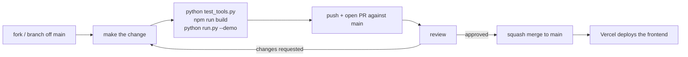

Before opening a PR, run the checks that exist today:

```bash
cd backend && python test_tools.py
cd ../frontend && npm run build
```

and, if you touched the event pipeline, watch a demo run end to end in the UI —
that is the only integration test the project has.

In the PR description, say:

- **What changed and why.** If it closes a numbered limitation above, say which.
- **How you verified it.** "Ran a demo run and watched the feed" is a real
  answer here.
- **Anything you deliberately did not do.**

### Commit message conventions

The history uses short, imperative, sentence-case subject lines with no prefix
and no trailing period:

```
Add a pixel-art office view
Add MIT license and a hosted demo
Rewrite the README as a guided walkthrough, add a platform tour
Fill in the nine remaining screens
Five new screens, ⌘K, and a real approval gate
Initial commit: AI Software Factory
```

Match that: imperative mood, ≤ 72 characters, describe the change rather than
the files touched. Add a body paragraph when the *why* is not obvious from the
subject. Conventional Commits are **not** used here.

### What makes a good contribution here

The bar is the same one the codebase holds itself to:

- **Do not add a feature the UI would have to fake.** If the data does not
  exist, the screen says so.
- **Do not add a field that could carry model reasoning** into an event payload.
- **Derive, do not duplicate.** New screens fold the feed; they do not keep
  their own state.
- **Explain the why in a docstring** when the design avoids a specific failure.

---

## 15. License

[MIT](LICENSE) — use it, fork it, build on it.

Copyright © 2026 Abdul Qadir Khan.

Built by **Abdul Qadir Khan** · [@aqkprogrammer](https://github.com/aqkprogrammer)

---

### Related documents in this repository

| Document | What it covers |
|---|---|
| [`START-HERE.md`](START-HERE.md) | The two-minute version of the setup above |
| [`backend/README.md`](backend/README.md) | The pipeline's three core ideas, and where it will break first |
| [`backend/BRIDGE.md`](backend/BRIDGE.md) | How events get from `run_agent()` to the office screen |
| [`frontend/README.md`](frontend/README.md) | The UI's file layout and its two data sources |
| [`client-acquisition-playbook.md`](client-acquisition-playbook.md) | Business notes on finding the first client — not part of the software |
