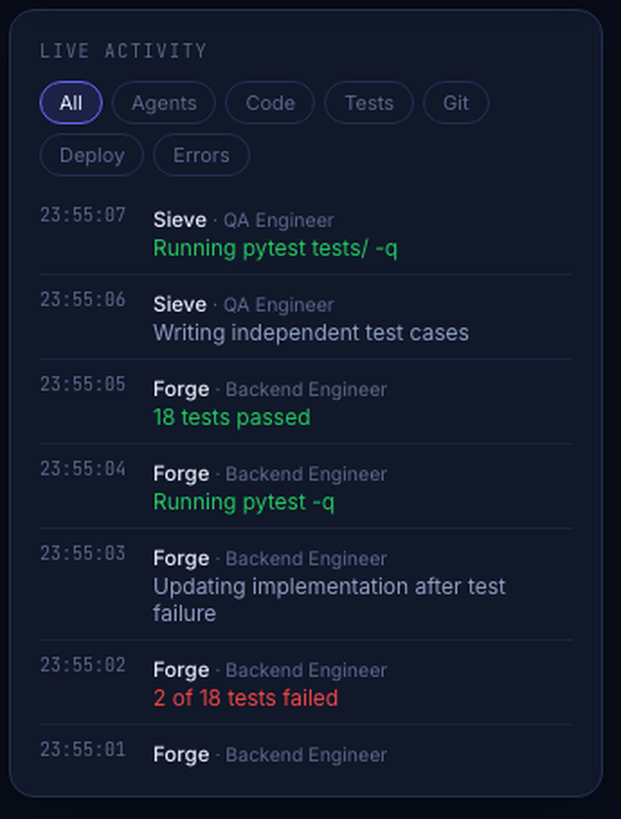

# AI Software Factory

**An AI engineering team you can watch work.**

Most AI coding tools give you a spinner and then a wall of diff. This one gives
you a floor plan. Twelve desks, each an agent with a name and a job. When the
backend agent reads a file, its monitor lights up. When the tester's suite goes
red, the desk turns red. When the reviewer approves, you see it happen — with a
timestamp, in a feed, on the same screen.


Everything above is a real screenshot of the running app. No mockups in this
README.

---

## Watch it run


Twelve frames from one run. Atlas breaks the work down, Forge writes the code,
the test suite fails, Forge fixes it, Sieve tests it independently, Lens reviews
the diff. Nobody typed anything after "go".

---

## The idea

An AI agency has an honesty problem: the client can't see the work, and often
neither can you. "It's 70% done" means nothing when the thing doing the work is
a loop you can't watch.

So this project starts from the observation instead of bolting it on:

```
   run_agent()                    the agent loop
       │
       │  every tool call emits an event, before it runs
       ▼
   EventBus  ──────┬─────▶  SQLite        every run is replayable
                   │
                   └─────▶  WebSocket ──▶ the office, live
```

The agent loop can't do work invisibly, because emitting the event is how the
work gets done. There's no separate reporting layer to drift out of sync.

**One rule holds the whole design together:** the UI renders a fixed table of
tool → phrasing. `read_file` becomes "Reading auth/service.py". There is no
field anywhere in the pipeline that carries model reasoning, so none can reach
the screen. You see what the agent *did*, never what it "thought".

---

## Six screens, one event stream

Every screen below is a projection of the same event log. Nothing has its own
data source, so no two screens can disagree about what happened.

### Command center — where the work stands


Agents working, tasks in flight, tests passing, tokens burned, and what needs a
human. The team list on the right is honest about scope: four desks are live,
eight say `not provisioned`.

### The pipeline, as a live graph


These are the stages `orchestrator.build()` actually executes, with state
derived from the event stream — not a diagram someone drew once and let rot.
Active edges animate; the fix loop is drawn going backwards because that is
what it does.

The test stage feeds failures back into the fix stage. That loop, capped at
`max_fix_attempts`, is what turns a code generator into something that
converges.

<br clear="right" />

### Task board


The planner writes this board and the coder moves cards across it. Priority is
the left edge, owner and progress at the bottom.

### Activity, with replay


Every event, filterable by kind and by agent. The histogram buckets events over
*time*, so bursts show up as spikes and model calls show up as gaps — and the
scrubber rewinds through real history, because the events were persisted on the
way through, not re-simulated.

### The human gate


The agents plan, write, test and review on their own. They stop here.
Approving posts back to the API, which emits the decision as an event — so your
answer shows up in the log like everything else.

### ⌘K

Every screen, every agent, every pending approval, and the actions worth having
on a keyboard. Arrow keys and Enter, bound at the window so a stray click can't
kill them.

---

## What's actually in here

### The floor plan


Hand-built isometric SVG — room plates, desks, monitors, seated staff, a status
marker over each head. The desk animates while the agent is working and settles
when it stops. Rooms tint when anyone in them is active, so you can read the
room from across the desk.

Four of the twelve desks light up on a real run: **Atlas** (planner), **Forge**
(coder), **Sieve** (tester), **Lens** (reviewer). The other eight sit `offline`
because those agents don't exist yet. That's deliberate — a fake-busy desk
teaches you nothing.

### The employee panel


Click a desk and you get what a manager would actually ask for:

- what they're working on right now
- the step they're on, and the ones left
- files changed, tool calls, tests passing
- tokens burned and what it has cost so far
- the raw terminal — the actual `pytest` output, not a summary of it

The numbers come from the same event stream as the animation, so the panel and
the floor can never disagree.

<br clear="right" />

### The activity feed



Every event, newest first, attributed and timestamped, filterable by kind. This
is the audit log and the live view at the same time — it's `SELECT * FROM
agent_events`, rendered.

---

## The pipeline underneath

```
requirement
     │
     ▼
  PLANNER ──▶ 3-8 ordered tasks           no filesystem access at all
     │
     ▼
  CODER   ──▶ writes, runs, fixes         six tools, one workspace
     │
     ▼
  TESTER  ──▶ PASS / FAIL                 did not write the code, does not trust it
     │
     │  FAIL ──────┐
     │             │  the report goes back to the coder as new input
     └─────────────┘  capped at max_fix_attempts
     │
     ▼
 REVIEWER ──▶ APPROVE / REQUEST_CHANGES   read and run only, cannot write
     │
     ▼
 human approval before anything ships
```

**Three ideas do the heavy lifting:**

**The tool allowlist is the permission system.** The reviewer can't write code
because the write tools were never handed to it — not because the prompt asked
it nicely. Every permission you add later is the same move.

**The tester never fixes.** The coder never grades itself. When the tester
reports FAIL, that report becomes the coder's next input. That loop is what
turns a code generator into something that converges.

**Everything is scoped to a workspace.** One directory, one project. `Workspace`
resolves every path and refuses anything that escapes the root — the sandbox
test is in `test_tools.py` and it runs without an API key.

---

## Run it yourself

Two terminals. Backend first.

```bash
cd backend
python3 -m venv .venv && source .venv/bin/activate
pip install -r requirements.txt
uvicorn server:app --reload --port 8000
```

```bash
cd frontend
npm install
npm run dev
```

Open **http://localhost:3000**. The top bar should say `backend up`.

### See it work without an API key

Click **Demo run**.

A scripted sequence flows through the real bus — SQLite, WebSocket, office. The
desks light, tests fail then pass, the reviewer approves. No model is called and
no file is written. It exists so you can prove the wiring end to end before
spending a cent, and it's what the GIF above is showing.

### Make it build something real

```bash
export ANTHROPIC_API_KEY=sk-ant-...
```

Restart the backend, type a requirement into the bar at the top of the office,
and hit **Start build**. Or skip the UI entirely:

```bash
cd backend
python run.py "Build a FastAPI task API with users, JWT auth and pytest tests" \
  -w ./workspace/task-api
```

Then read what the agents actually wrote in `backend/workspace/task-api/`.

> **The agents run shell commands.** They are scoped to the workspace directory,
> but `run_command` executes whatever the model decides to run. Use the included
> `docker compose` setup once you've seen it work — that's what it's for.

---

## Stack

| Layer | Choice | Why |
|---|---|---|
| Agent loop | ~160 lines of plain Python | No framework. You can read all of it in one sitting. |
| Models | Anthropic (default), OpenAI, xAI | One adapter; the loop never learns which is live. |
| Events | SQLite + in-process pub/sub | Replayable from day one. Swap `_fanout` for Redis when one process isn't enough. |
| API | FastAPI + WebSockets | The run blocks on a worker thread; events cross back via `call_soon_threadsafe`. |
| UI | Next.js 15, React 19 | Client-only — it's a live view, there's nothing to server-render. |
| Graphics | Hand-written SVG + CSS keyframes | No game engine, no 3D dependency, no canvas. |

Zero UI dependencies beyond React, Next, and an icon set. The floor plan is
`iso(gx, gy) => ({x: (gx-gy)*TW, y: (gx+gy)*TH})` and about 200 lines of
polygons.

---

## Layout

```
backend/
  agency/tools.py         six tools; Workspace enforces the sandbox boundary
  agency/runtime.py       the agent loop — this is the core concept
  agency/agents.py        four agents = system prompt + tool allowlist
  agency/orchestrator.py  plan -> code -> test -> fix -> review
  agency/events.py        the bus: SQLite + WebSocket fanout
  agency/demo.py          scripted run, no key required
  server.py               FastAPI bridge
frontend/
  components/Shell.jsx           sidebar, top bar, routing, ⌘K
  components/office/Floor.jsx    the isometric floor plan
  components/screens/            command center, workflow, tasks, activity, approvals
  lib/useRealtime.js             snapshot, then live, with reconnect and dedupe
  lib/mockEngine.js              the simulation, for when the backend is down
  lib/types.ts                   the UI/backend contract
```

| Route | Purpose |
|---|---|
| `POST /runs` | Start a build. Returns immediately; one at a time. |
| `POST /runs/demo` | Scripted run. No key, no model calls, no files written. |
| `POST /approvals/{id}` | Answer a gate: `{"decision": "approved"}`. |
| `GET /health` | Provider, model, and whether the key is actually set. |
| `GET /state` | Snapshot for first paint: agents, tasks, approvals, events. |
| `WS /stream` | Replays recent events, then streams live. |

---

## Where it breaks

Written down honestly, because a demo that hides its edges isn't worth showing.

1. **Context.** The coder re-reads files every task and burns tokens. Fix: a
   compact repo map plus a summary of what previous tasks changed.
2. **Drift.** Task 4 can contradict task 2. Fix: an architecture artifact the
   planner writes and every coder task reads.
3. **Crash recovery.** A failed run loses its state. Fix: persist task state,
   make runs resumable. This is where a durable workflow engine starts to pay
   for itself — not before.
4. **One process.** Two concurrent runs would interleave into one office. The
   `run_id` column already exists; the socket needs to filter on it.
5. **Eight empty desks.** Frontend, database, security, and devops agents are
   roster entries, not implementations.

Nine sidebar screens are still placeholders (Projects, Code, Testing,
Security, Deployments, Analytics, Costs, Settings, AI Employees) — they say so
rather than showing fake data.

---

## License

Not yet licensed — all rights reserved for now.
